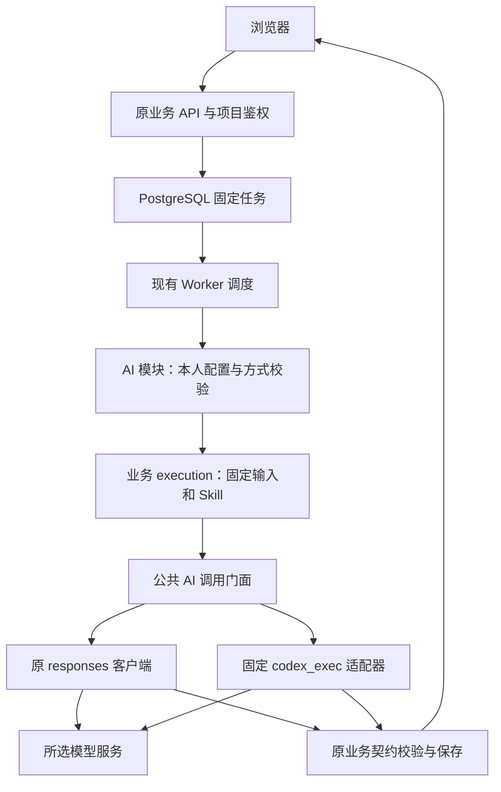

# API / Codex CLI 双调用方式接入方案

<!-- document-status:start -->
> **历史资料，不再作为当前开发或运行规则。** 双调用方式已实施，旧阶段门槛不再使用。 当前说明见[AI_CODEX_CLI_IMPLEMENTATION.md](AI_CODEX_CLI_IMPLEMENTATION.md)。 查阅分类见[文档整理清单](DOCUMENT_REVIEW.md)。
<!-- document-status:end -->

2026-11-11 · 原方案及阶段基线。实施状态见 [AI_CODEX_CLI_IMPLEMENTATION.md](AI_CODEX_CLI_IMPLEMENTATION.md) 与 SESSION_CONTEXT 最新交接；下文“尚未实施”描述方案编写时状态。用户已确认在个人 AI 设置中区分「API / Codex CLI」的界面方向。本文件描述拟议实现；当前生产代码仍只有 API 调用，尚未增加配置表、迁移、CLI 执行或并发调度。

## 1. 交付目标

个人 AI 服务提供两种独立配置，用户明确选择本次使用方式；分析页面继续沿用现有提交、排队、进度、报告和人工审核操作。浏览器只访问平台 HTTP 接口，CLI 在后端运行，用户电脑无需安装 CLI。

| 项目 | API | Codex CLI |
| --- | --- | --- |
| 实际执行 | 原公共 Responses HTTP 客户端 | 后端固定的 `codex exec` 适配器 |
| 配置 | 本人的 API 地址、模型、推理强度、Key | 本人的 CLI 服务地址、模型、推理强度、Key |
| 凭据存储 | 保留现有 `ai_connection` | 新增独立 CLI 配置，沿用后端加密 |
| 返回内容 | Responses SSE / 完整 JSON | CLI JSONL 事件及最终结构化候选 |
| 失败处理 | 显示真实失败，人工重试 | 显示真实失败，人工重试 |
| 自动切换另一方式 | 不执行 | 不执行 |

CLI 仍需要连接模型服务。同一中转、账号的限流、上下文、过载和长请求限制不会因为改成命令行而自动消失。本方案提供可选择的调用实现和可比较的诊断，不承诺修复已有的 HTTP/2 中断。

首期只接入用户自己的 API Key；不使用服务器个人 Codex 登录，不接入共享 ChatGPT 登录态，不将多个平台用户映射到同一个订阅账号。

## 2. 个人 AI 设置交互

保持平台设置现有入口和容器，使用主题 `FormSelect` / `Form`：

```text
个人 AI 服务
当前已保存方式：API

调用方式         [ API / Codex CLI ]

配置名称         [ 当前方式自己的名称 ]
服务地址         [ 当前方式自己的 Base URL ]
模型名称         [ 选择或输入 ]
推理强度         [ 选择 ]
API Key          [ 已配置；留空保留，填写替换 ]

[测试当前方式]   [保存并使用]
```

- 选择方式只切换当前编辑表单；切走前保护未保存内容，不覆盖另一套已保存配置。
- 正常点击「保存并使用」时，原子保存该方式的个人配置并设为当前方式；明确提示新任务将使用此方式。仅切换到已保存配置且内容未改时，只递增偏好版本，不重写密文或递增配置版本，避免影响旧任务。
- 测试只验证当前表单，不保存配置、不切换方式。远端模型测试明确提示可能计费；保存不触发测试。
- API 继续原模型列表入口。CLI 首期允许手动填写模型；不能仅凭 API 模型列表就声称 CLI 兼容。
- CLI 表单显示后端运行环境「可用 / 未安装 / 版本不受支持 / 未验证」信息。可执行文件路径和任意参数不作为用户可编辑字段；本地可用检查与真实模型测试结果分开。
- 分析提交前及任务详情显示调用方式、模型和配置名称；错误提示区分 API 返回错误与 CLI 运行/协议错误。
- 后端 CLI 不可用时，仍可显示个人配置；保存按钮明确改为「仅保存配置」，不激活。响应同时返回当前实际方式及未激活原因，禁止提交 CLI 任务。不能把仅保存显示为调用方式切换成功。

实施 UI 时先同步总 HTML 原型，再实现正式组件；保留现有菜单和分析页面布局。完整方案确认前不修改总原型或运行页面。

## 3. 数据与个人 Key

现有 `AIConnection` 主键等于用户 ID，`owner_id` 唯一，只能保存一套配置。仅增加 `mode` 字段会导致切换时覆盖地址、模型和 Key，因此采用独立存储。

| 记录 | 拟议字段与用途 |
| --- | --- |
| `ai_connection` | 继续保存现有个人 API 配置，原主键、密文、版本和历史记录保持 |
| 新增 `ai_cli_connection` | `owner_id` 主键；`name / base_url / model / reasoning_effort / encrypted_key / version / updated_at`；每个用户一套 CLI 配置 |
| 新增 `ai_call_preference` | `owner_id` 主键；`call_mode / version / updated_at`；只保存本人当前选择及并发修订号 |
| 并发阶段新增 `ai_call_reservation` | 按调用请求 ID 唯一保存所有者、任务/测试类型、服务/凭据分组、调度归属及预留状态；供 API 进程与 Worker 共同约束并发，不保存明文 Key |

`call_mode` 枚举为 `RESPONSES_API / CODEX_EXEC`。没有偏好记录的旧用户按 API 解释，不自动创建 CLI 配置、不复制 API Key。两套 Key 可以由用户自行填写相同值，但系统不替用户拷贝。

新表与主键均关联真实用户；表、字段及枚举/空值语义必须有 ORM 和真实 PostgreSQL 中文 COMMENT。使用独立 Alembic 迁移；方案阶段不运行迁移。迁移不启用历史平台密钥，也不复用已停用的 `ai_source` 字段。

Key 继续用现有 `AI_ENCRYPTION_KEY` 和 Fernet 加密。后端根据可信任务身份读取所选方式的本人配置并解密，前端仅接收 `has_key` 等元数据。接口沿用既有加密提交，不将密钥写入任务快照、CLI 命令行、配置文件或公开日志。

CLI 创建时，为该子进程单独构造最小环境，将本次 Key 注入受控 provider 的 `env_key` 指向的变量；官方认证路径也支持单次运行的 `CODEX_API_KEY`。具体选择一种经过验证的固定映射，不同时混用多套认证。绝不通过修改父进程 `os.environ`、公共配置或反复 `codex login` 切换用户。

## 4. 公共调用链与模块职责



上图表示执行顺序；代码依赖保持既有分层：

- `modules/ai/schemas.py / service.py / router.py`：保存两种个人配置和当前方式，校验本人身份、版本及能力；只在服务层解密。
- 新增公共 `integrations/ai_client.py`：根据显式传入的方式分发，提供原 `analyze / converse` 所需公共能力；配置通过普通数据契约传入，不查询数据库或导入业务模块。
- 原 `integrations/responses.py`：继续负责现有 HTTP / SSE 协议，不在其中隐式启动进程或读取 CLI 登录文件。
- 新增 `integrations/codex_exec.py`：仅实现固定 CLI 调用、并行消费输出、事件解析、进程控制和安全诊断，不承载报告、项目权限或数据库操作。
- 各业务 `execution`：仍负责资料、附件、Skill 快照、取消检查、契约校验、候选和历史保存，只改为调用公共门面。

需求、代码、变更、用例分析、用例生成、独立对话与 Skill 助手的现有公共调用点统一检查和替换；不能只改 `responses.py`，也不能留下直接读取旧 `AIConnection` 后绕过所选方式的路径。旧历史批次兼容分支保持可读，实际重发的方式明确记录。

个人配置接口保留现有 API 配置路径和仅保存语义，旧客户端不提交偏好时不得隐式改变当前方式。新增接口明确区分「仅保存」「保存并激活」「激活已有配置」；新 UI 正常使用保存并激活，CLI 不可用时只能仅保存。激活不修改未变更的配置版本。需要同时保存和切换时，在服务层同一事务内完成，带配置和偏好各自修订号，防止两个窗口互相覆盖；具体路径与响应在实施前写入模块契约。

## 5. 固定任务、执行与结果

任务入队记录 `call_mode`、对应配置版本、模型/强度、客户端版本、请求 ID，以及原输入/Skill 的版本与哈希，不含 Key。执行时重新核对用户有效性、资料权限及该方式的配置版本。

运行中修改当前方式不影响已排队或执行中的任务：调度器按任务固定方式读取配置，不重新读取偏好分流。该方式的配置本身发生变化时，明确报告版本冲突，交由用户决定新尝试，不使用历史 Key 或另一方式补位。

CLI 执行固定为：受控输入准备 → 固定可执行文件和参数 → stdin 发送输入 → 读取 JSONL 和 stderr → 核对终止状态 → 保存私有候选 → 原业务校验。使用参数数组与 `shell=False`；Windows 使用实际 CLI 可执行文件，不能依赖 PowerShell/CMD 包装器。版本作为部署依赖固定，不自动升级或自动安装。

每次尝试有独立资料目录、CLI 配置/会话目录、输出文件和请求 ID；固定受控 provider、地址、模型及参数。资料正文不拼成 shell 命令。不同任务不能使用 `resume --last`；如未来需要恢复会话，必须使用明确绑定用户/任务的 session ID，另行验证其语义。

stdout / stderr 同时消费，防止管道写满。保存安全事件类别、阶段、时间、退出码、请求/响应标识和字节数；CLI 原始事件可能包含资料或命令，不能原样写公开日志。原件沿现有私有候选保护和清理策略管理。

进程退出码 0 或 `turn.completed` 只证明 CLI 这一轮结束；最终内容仍需非空、JSON 结构、真实引用和对应业务契约全部通过。缺字段、不完整结果、坏 JSON 或 `turn.failed` 明确失败，不通过切换 API、修剪资料或自动补调用掩盖。

旧任务缺少方式时按 API 解释；历史输入、Skill、原响应和人工审核状态不改写。人工重试默认保留原方式，若用户要求换方式，必须显式创建新的调用尝试并留存来源，不能改写旧尝试。

## 6. 并发与取消

当前 Worker 用 PostgreSQL advisory lock 保证单实例，领取后同步执行，实际为全局串行。接入 CLI 不会自动获得并发，也不能直接启动多个同款 Worker：额外实例会取不到锁。

建议先串行验证 CLI 接入，再在同一调度 Worker 内引入有界执行槽。建议初始总并发 2、单用户 1，参数由后端部署配置控制；这是方案值，尚未生效。调度还需按真实凭据/服务限制：不同用户填写同一个 Key 时也不能绕开该凭据的并发上限，凭据分组标识使用服务端带密钥摘要，既不保存新的明文 Key，也不公开摘要。

- 使用现有 PostgreSQL 队列和原子领取；没有空槽保持 `QUEUED`，不先领取大量任务变为 `RUNNING` 后在内存等待。
- 每个执行槽使用独立数据库 Session，网络或进程等待时不占用长数据库事务；报告提交前重新校验用户、取消状态及尝试请求 ID。
- API 与 CLI 后台任务纳入同一全局/用户预算。由于连接测试位于 API 进程，仅有 Worker 内存槽不能共享限额：并发阶段增加 PostgreSQL 调用预留记录，通过短事务和固定锁顺序原子检查总数/用户/凭据预算并预留，调用结束后释放。连接测试也必须先预留，额度不足时明确返回忙，不另开绕过预算的调用路径。先设计并审查预留表的模型、中文注释和迁移，再启用该阶段。
- 取消监控独立于 stdout 回调，CLI 完全静默时也能检查取消状态。只终止该次尝试拥有的进程树；Windows 采用经过验证的 Job Object 等进程归属机制，不能用系统级按进程名批量终止。
- Worker 退出时清理其子进程。数据库连接或 advisory lock 所有权丢失时，即使 Worker 进程仍存活，也立即停止领取，并终止或核验本调度器所有活动调用；不能在旧 CLI 仍运行时重新进入 `recover` 并开始下一轮调度。无法确认本地调用已结束的预留不按超时直接释放，须先核对执行归属与状态，避免越过限额或重复执行。
- 恢复后将状态不明的调用明确标记为中断，不自动重放或收费重试。进程归属结合运行句柄、启动信息和请求 ID，不仅依赖可复用的 PID；异常进程的预留经归属核验后回收，不以释放并发槽为由重新发起模型请求。
- 关闭或刷新浏览器不取消任务。取消本地进程只保证本地停止接收和提交，不能保证供应商立即停算或免计费。

## 7. CLI 接入前必须验证的差异

| 差异 | 处理方案 |
| --- | --- |
| CLI 是 Agent 执行入口，可能多轮请求或自动压缩上下文 | 不把一次进程启动等同一次模型请求；核对固定版本能否控制额外调用、压缩和重试，无法满足既定完整输入语义的路径不开放 |
| 默认可能加载个人配置、登录态、MCP、插件、仓库指令与工具 | 使用独立受控运行配置，仅提供本任务资料/固定 Skill；不继承服务器个人环境，不开放任意脚本/命令参数 |
| `read-only` 和独立目录不足以隔离租户 | 工具禁用能力和系统级隔离都需验证。多用户开放前，须证明无法读取平台环境、数据库/加密主密钥或其他任务；未达到时 CLI 不标为可用 |
| CLI 有默认 SSE 空闲超时和重试 | 不能直接继承默认后宣称“不限时、不自动重试”。验证禁用重试和超时配置的实际语义；不增加分析总时限，无法关闭的 CLI 自身约束必须披露并决定是否符合接入条件 |
| CLI JSONL 是执行事件流 | 不能把每个事件当成一组完整用例；继续按业务契约校验最终候选 |
| 原 API 支持图片/PDF 等附件 | CLI 先验证文本和结构化结果。图片在原生 `--image` 映射及完整性验证后开放；PDF 等未验证附件明确拒绝并提示用户选择已支持方式，不静默转纯文本或自动换路 |
| CLI 自带系统指令与当前 API 消息结构不同 | 保留业务输入和 Skill 的完整原件/哈希，验证输入映射；不承诺两种方式输出完全相同，不通过工具扩大来源范围 |

当前查询到的官方配置说明列有流空闲超时和 HTTP / SSE 重试设置；不能假定某个未验证值（例如 0）代表无限等待。任务模型调用数无法准确观测时标为未知，不能用进程数或 `turn` 数冒充收费请求数。

用户此前提出的“业务分段保存、只补未完成段”仍是独立的输出契约改造，草案在 `skill/case-generation/segmented-output-draft.md`。本方案不修改该 Skill 或把分段能力算作 CLI 天然提供；若实施，需同时改 Skill、分段解析、持久化和重发契约，另行验证。

## 8. 实施顺序和验收

1. **方案与总原型**：确认两套独立个人配置、保存后切换、任务固定方式和首期能力范围；同步现有总原型，核验两方式、空配置、运行环境不可用、窄屏和未保存状态。
2. **无收费技术验证**：锁定 CLI 版本，以模拟可执行进程/假 provider 验证事件、标准输入、认证注入、参数隔离、失败/取消和 CLI 自身重试/超时配置；隔离环境与工具约束未验证前不发送公司资料。
3. **配置和公共客户端**：实施模型与 Alembic、双配置及偏好接口、公共门面和固定 CLI 适配器，旧 API 回归保持。
4. **串行接入全部目标调用点**：先沿原 Worker 串行执行，验证配置/方式固定、候选/业务校验和历史兼容；CLI 不支持的输入在提交前明确提示。
5. **有界并发**：在模拟和真实 PostgreSQL 回滚测试通过后，启用调度槽，覆盖用户/凭据限流、任务领取、取消和 Worker 重启。
6. **真实验证及启用**：单独明确账号、数据范围和最多调用次数，再执行真实模型验证；完成前端视觉、端到端和错误验证后才启用 CLI。用户选择 API 继续原调用路径。

必须覆盖的回归包括：用户 A/B 同时使用不同伪 Key 不串配置/目录；切换方式后旧任务不漂移；密钥不出现在命令/日志/结果；两个窗口保存冲突；输出管道大量写入；CLI 静默取消、进程崩溃及 Worker 重启；重复请求和晚到结果；exit 0 无有效结果；长输入完整性；附件不支持；CLI 不存在/版本不匹配；禁止自动回退和重复收费调用。

实施时执行架构测试、相关模块/公共请求回归、数据库中文注释与 Alembic 一致性/真实落库核对、Ruff、前端 check/build/UI 检查和浏览器视觉验收。模拟结果不能替代真实 CLI/模型集成验收。

## 9. 参考与当前交付边界

- 当前实现：`backend/app/modules/ai/service.py`、`backend/app/db/models.py`、`backend/app/chat_worker.py`、`backend/app/integrations/responses.py`、`frontend/src/AIService.tsx`。
- [OpenAI 官方非交互调用说明](https://learn.chatgpt.com/docs/non-interactive-mode)：`codex exec`、JSONL、最终结构化输出及单次认证。
- [OpenAI 官方配置参考](https://learn.chatgpt.com/docs/config-file/config-reference)：provider、环境密钥、流空闲超时和重试。

本轮仅交付设计文档；CLI 的并发、隔离、附件、超时与收费次数控制均未完成实现或真实验证，不表示当前系统已具备这些能力。没有迁移、重启、部署、远端写入或真实 AI 调用。
