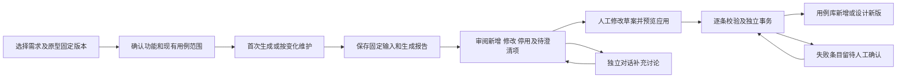

# 用例生成专项方案

<!-- document-status:start -->
> **历史资料，不再作为当前开发或运行规则。** 生成方案已由完整输入和当前审核流程替代。 当前说明见[CASE_GENERATION.md](CASE_GENERATION.md)。 查阅分类见[文档整理清单](DOCUMENT_REVIEW.md)。
<!-- document-status:end -->

2026-10-12最新：用户要求完整正文和对应/公共批注直接给AI生成，用例输出仅保留设计字段和简短待确认说明；新准备采用Skill2.0.0/契约3，cases/notes/complete代替规则树、场景树和逐片段覆盖。模型先完成有明确依据的适用场景；业务明确、准备不足仍设计，缺业务预期才留问题。complete是模型范围声明而非已证明覆盖，调用结束与范围完成分别显示。不增加自动分批/前置AI识别，大输入提示后由用户继续或缩小范围。已有人工审核/逐条事务、优先复用、停用恢复、历史与14列规则保留，旧契约2按固定版本读取不改写不重跑。详情见[当前实现](CASE_GENERATION.md)、[简化契约](../skill/case-generation/contract.md)；下方树状分析及旧分批方案仅为历史。

2026-10-12用户确认用例生成门槛调整：Skill1.1.0/契约2兼容新增DESIGN_READY_SETUP_PENDING场景状态；业务条件/动作/预期明确即可NEW/UPDATE待审阅建议，缺账号/数据/权限/观察入口关联EXECUTION_SETUP并写入data_requirements/remark和场景note，NEEDS_REVIEW要求人工核对。缺业务决定仍PENDING_DECISION、错证据/引用仍拦截；未完成分析不能冒充业务缺失。执行准备可与已生成用例并存，不宣称可直接执行/已测，准备缺口存在不能COMPLETE。Skill加强完整功能适用分支覆盖及具体遗漏说明。页面分别展示业务待澄清、准备待补和未覆盖原因/下一步，PARTIAL显示部分完成。旧Skill/固定输入/报告不改写、不自动补生成；保留14列、人工审核及逐条应用。无新增表/字段/迁移/依赖。

2026-10-12最新确认：新建生成采用完整资料一次调用本人AI，不自动分批、不增加前置AI规则识别。正文片段仅用于证据定位；原功能范围、资料、旧新配对及所选用例全部保留。准备后展示文本token粗估（ASCII约4字符/token，非ASCII约1字符/token，含固定Skill和JSON）；达到32,000为提示阈值，非模型硬限制。模型容量目前无可信配置，不猜测模型上限；附件用量单独提示、未计入文本估算。用户可继续开始或缩小范围重新准备，保留原准备记录，未开始不收费。平台已有16MiB输入/附件校验上限继续生效。移除分批规则确认，失败人工重试，成功成果/历史分批记录保持；截断响应不标完成，不把不完整片段当合法候选。

2026-10-12最新授权“接入功能”后，正式/generate已接Skill1.0.0/独立契约2、本人AI/Worker、项目保存与人工逐条应用/审核及对话。当前实现和容量/验证边界见[CASE_GENERATION.md](CASE_GENERATION.md)；下方待接入/无后端等为旧设计状态。复用按已确认总原型追加本次审核，保留设计和测试记录；不扩大自动测试/Git写。

2026-10-12用户授权参考testcase仓库设计Skill，已形成[Skill设计](CASE_GENERATION_SKILL_DESIGN.md)、`skill/case-generation/`0.1.0-draft和独立候选契约2。第8节建议契约1早于现有v1展示预览；本次v2明确与它区分，尚未接正式解析/AI/后台或应用。已确认v0.2业务不变；下文“无Skill/获准接入时建立”是历史状态，不再指文件不存在。

2026-10-10后续用户授权先开发页面、不接AI/Skill，正式/generate已按v0.2布局接入范围、双JSON本页预览、人工草稿/澄清、只读当前库比较与导出。范围/结果暂存于页面内存，正式AI/任务/入库及停用等后端尚未实现，详见[CASE_GENERATION.md](CASE_GENERATION.md)。本稿的完整业务规则继续作为后续实现要求，不因页面存在扩大为真实调用/建表授权。

## 2026-10-09：设计审阅后确认的规则

本节及下文v0.2以本轮用户逐项答复为准，替代旧稿的“应用后待审核”“维护必须有生成记录”“重复仅跳过”“整批失败回滚”和“用户自行拆分大范围”等建议。用户再次要求修改原型后，总HTML与审阅副本已同步这组规则的合成演示，见[原型说明](CASE_GENERATION_PROTOTYPE.md)；正式前后端/AI/Skill仍未接入。

| 已确认事项 | 业务行为 |
| --- | --- |
| 统一确认即设计审核 | 人工确认并成功应用的新增/修改版本为已审核、未测，测试人员为空；记录确认人与时间。生成/保存草稿本身不完成审核 |
| 维护已有用例 | Excel导入与手工用例同样支持维护，保留身份、编号、人工内容和历史；历史生成记录不是进入维护的前提 |
| 优先复用 | 同一场景优先建议关联已有用例，有差异才建议修改；确认复用后记录内部ID/设计版本并结束该候选处理，疑似重复仍由人工核对 |
| 人工需求澄清 | 页面可确认业务结论，保存确认人/时间/依据版本；后续只补生成受影响场景，保留原报告与人工修改 |
| 首次500+条 | 一次发起，按功能和输入大小自动分批调用本人AI，统一记录、持续进度；发起前展示分批计划及多次调用费用提示，失败批次人工重试，已完成结果保留 |
| 单条失败继续 | 统一确认一批后逐条应用；失败项不写成功，记录原因并交人工确认，继续下一条；成功项保留，不因后续单条失败回滚 |

这里的“执行下一条”是将候选应用到用例库，不增加自动执行测试的业务能力。实际测试结果仍由既有用例管理记录。

2026-10-09后续：用户要求“改下原型”，已按本稿同步总HTML及审阅副本，供页面和流程审阅，详见[CASE_GENERATION_PROTOTYPE.md](CASE_GENERATION_PROTOTYPE.md)。本稿下方“仅设计/未改HTML”是方案形成时的边界；本次扩大至HTML演示，不扩大至正式前后端、数据库、AI/Skill或Git写权限。

设计稿 v0.2 · 2026-10-09。用户已审阅并确认上表规则；其余新增页面交互、正式契约和实施阶段仍需按业务边界落地。本轮没有获得正式开发或真实AI调用授权。

## 1. 目标、依据与当前实现

用例生成回答两个问题：所选完整需求应该怎样测试；需求更新后，已有用例应该怎样维护。产物先是可追溯的用例建议，经人工核对才进入用例库。生成成功、人工应用、用例审核、测试通过分别记录。

依据：[用例管理](CASES.md)、[分析输入输出](ANALYSIS_INPUT_OUTPUT_DESIGN.md)、[其他分析功能方案](OTHER_ANALYSIS_DESIGN.md)、[需求风险报告](REQUIREMENT_RISK_REPORTS.md)、[代码分析](CODE_ANALYSIS.md)、[变更分析](CHANGE_ANALYSIS.md)、[架构](ARCHITECTURE.md)和[代码规范](CODE_STANDARDS.md)。

本轮按源码复核的现状：

| 能力 | 当前状态 | 本方案的复用或新增边界 |
| --- | --- | --- |
| 用例管理 | cases模块已实现分类、设计版本、测试/审核记录、库revision、导入判重及逻辑删除 | 复用字段、项目锁、编号及版本语义；候选应用和生命周期停用需新增 |
| 用例生成 | App中的`/generate`仍由Pending承接；没有生成业务模块或Skill | 本轮仅设计，不把总原型的模拟任务当正式功能 |
| 需求分析 | 已有v3固定input/report、功能风险、人工处理和独立对话 | 用户主动选入固定依据和结论；风险不是唯一需求来源 |
| 代码分析 | 已有v2固定源码、报告、人工处理、本人AI任务和对话 | 可选参考报告，不自动扩大代码读取或调用范围 |
| 变更分析 | 正式页面仅保存前端内存范围/预览，尚无正式报告和AI任务 | 未来可带入固定变化依据；当前不能假定其记录已有服务端ID和可复用正文 |
| 模板管理 | 正式业务待接入 | 首期使用平台默认14列字段契约，不伪造可选模板；模板正式接入后再冻结其版本 |
| Worker | `app.chat_worker`轮流处理需求/代码分析和两类对话 | 获准开发后扩展显式任务类型；不恢复旧analysis_worker |

总HTML及审阅副本已同步首次/维护、批量审核应用、复用、澄清及512条分批的v0.2演示，并更新对应检查。新建和澄清补生成只保存待接入范围；大批次状态使用明确合成示例和演示推进，不把UI演示当正式后台/模型调用。菜单名称、位置及14列顺序沿用。

## 2. 产品流程与职责

- 需求分析负责发现需求风险；用例生成从完整依据设计可执行场景，不强制先完成需求分析。
- 用例分析负责审查现有用例是否符合需求及是否缺失；其完整修改草案未来可复用同一人工应用通道，无需为入库再调用一次生成。
- 代码报告可帮助指出值得验证的实现风险。代码行为不能直接变成业务预期；需求与代码冲突时展示双方，预期依据不足进入待澄清。
- 变更结果可以帮助定位维护范围。用户确认带入和发起后才执行，不建设自动分析流水线。
- 生成设计不执行测试，不产生测试通过，不修改需求、代码或GitHub。

## 3. 两种生成模式

### 3.1 首次生成 INITIAL

流程：命名 → 勾选资料及版本 → 声明完整/指定功能范围 → 选择判重用例范围 → 可选风险或人工结论 → 关注点 → 核对本人AI与发送范围 → 发起。

需求或原型至少选择一项，必须有实际可读内容。仅原型可为有明确交互和预期的场景生成用例；缺少权限、库存、金额或状态规则时提出问题，不把常见经验写成产品事实。

“完整生成”只指本次声明的完整资料与功能范围。未选文档、未读页面或未附加附件不能算已覆盖；选择指定功能时，其名称和范围说明在准备阶段冻结，功能别名由报告内key定位。来自已有报告的功能还需保存report_id，不能仅用名称或F1合并。

已有用例可为空。非空时选择整个项目、分类/筛选结果或勾选用例，冻结内部ID、设计版本和完整设计字段。页面显示用于AI判重的实际数量和范围，默认“不对照已有用例”，固定0条；需要对照时由用户主动选择整个项目、分类或勾选用例。应用前仍在项目用例库核对重复。500+范围按第10节在同一记录内拆分，不能静默截断；单个不可拆分场景超限时明确报缺口。

首次生成优先关联已覆盖同一场景的现有用例，仅缺失场景提出新增；疑似重复需核对，明确差异形成修改建议并说明依据。用例生成负责设计及维护，用例分析仍负责专门的符合性/质量审查，不强制为同一维护草案再调用一遍分析。

### 3.2 按变化维护 UPDATE

流程：选择当前用例范围 → 选择新需求及可用旧基准 → 有旧资料时配对/指定更新方式 → 核对可取得的历史与当前人工版本 → 发起 → 审阅复用、字段差异和冲突。旧生成/维护记录作为可选基准，不是唯一入口。

| 依据 | 必须保留的内容 | 缺失处理 |
| --- | --- | --- |
| 旧需求基准 | 旧固定需求/原型正文、片段及版本，可来自资料库或已有报告 | 可按当前新需求核对用例；标明无历史对照，不认定何时变化或因为未提及而停用 |
| 新需求 | 与旧范围配对的实际新内容，各资料组明确完整替换或增量补充 | 不把仅有URL、文件名或目录列表当新正文 |
| 上次用例基准 | 可取得的上次实际应用/设计版本及内容 | 仍可维护导入/人工用例；无法证明人工改动来源时标待核对，未应用草案不能冒充历史库版本 |
| 当前人工版本 | 当前用例完整内容、版本、分类和状态 | 与上次基准比较，保留人工改动；删除/停用需显式展示 |

增量补充先组成“旧有效内容＋新增/明确覆盖内容”；补充文件未提及旧规则不等于删除。完整替换也只对明确配对的范围生效，不能因本轮没选择某功能便建议停用其用例。多组资料可以选择不同更新方式。

更新按字段比较：上次实际应用基准G、当前人工版本C、本次需求要求的建议N。

| 情况 | 建议行为 |
| --- | --- |
| C=G，且新需求使N改变 | 提出字段修改，仍需人工应用 |
| C≠G，N仍接受C | 保留人工内容，不生成回退补丁 |
| C≠G，同一字段N与C冲突 | 展示G/C/N及双方理由，进入冲突，不自动合并 |
| 人工与需求变化影响不同字段 | 可以提出仅修改必要字段的草案，逐字段展示；其他字段保持C |
| 需求已删除或明确不适用该场景 | 提出停用建议，给出旧新证据；默认不勾选 |
| 没有变化且确已检查 | 在报告范围记录保持不变，不逐条挤占待处理列表 |
| 用例来自导入/人工且没有生成血缘 | 支持用当前新需求和可取得旧需求维护，保留当前人工版本；标记无法证明改动来源，不声称已完成三方保护 |

上次报告可分批应用。选择历史基准时展示已应用/复用/未应用及失败范围，只有成功映射能作为已采用的版本依据。忽略、失败或未应用的建议保留历史；每次成功应用形成实际版本映射，不静默改写旧报告。

## 4. 生成内容与质量要求

按功能识别角色、前置状态、触发操作、状态变化及可观察结果，再设计场景。重点包括正向流程、明确的拒绝条件、边界、权限、状态时序、重复提交和需求指出的失败恢复；只在有依据时采用，不为凑数量机械排列所有类型。

每条用例是一条能执行和判断的场景：前置条件说明初始状态和必要数据，步骤说明角色及动作，预期说明页面/接口/业务数据可观察结果。需要后台查询的断言说明验证位置和权限；未提供的SQL、接口、错误文案、阈值和状态名称不得编造。

AI候选建议要求title、steps、expected非空；可无前置条件。缺关键预期时输出待澄清问题。此要求只针对生成候选，不改变现有人工新建和文件导入允许留空的规则。优先级可以提出P0–P4并说明依据，属于测试设计建议；无法判断时留空。用例类型仍为自由文本，可包含业务流程，常用类型只作建议。

场景级预期可以对应多个步骤，不要求步骤和预期行数相等。不把“符合需求”“正常显示”“操作成功”作为唯一预期。

以已有配件订货示例说明时序要求：APP先选配件并填写确认信息，再由品牌方下架规格或冻结门店，最后APP提交。生成用例应验证提交时的拒绝规则及订单未被创建；不能改为“开始就选择已下架配件”。若原文没有确认提示语或数据断言，标记待核对而不补造。

## 5. 页面与交互建议

建议采用当前代码分析式“左记录、中结果、右固定依据”三栏，降低不同分析页面的切换成本。相较[其他分析方案](OTHER_ANALYSIS_DESIGN.md)早期累计功能主导航，这是新布局建议，待总HTML审阅确认；不改菜单，不增加独立报告管理页。

### 5.1 主页面

- 顶部：新建用例生成、导入生成结果、历史对话、打开用例管理。
- 左栏：生成记录，显示模式、范围、资料版本、发起人/时间、任务状态及已应用数量；记录分页加载和筛选。失败/取消不能显示为生成0条。
- 中栏：当前记录摘要与功能筛选；“用例建议”“冲突与待澄清”“完整报告”三个页签。按功能/场景汇总新增、复用、修改、停用及未覆盖范围，可按待审阅/已应用/已复用/已忽略/应用失败筛选；失败项列出原因与人工处理入口。每页10条，跨页选择；保持不变不逐条堆卡片。
- 右栏：当次固定需求/原型、更新配对、已有用例判重范围、相关报告/人工结论、Skill版本与限制；显示资料已更新提示，但本记录仍看旧快照。
- 空态说明先选择资料；PARTIAL报告显式显示未处理范围。没有新增也可以完成有效分析，不能伪造一条用例保证非空。

本期不默认跨记录汇总相同功能或合并同一用例的建议。可选择多记录组合导出带来源的清单；各记录结论和应用状态保持独立。

### 5.2 新建弹窗

字段顺序：名称 → 模式 → 资料/可用旧新配对 → 功能范围 → 当前用例范围 → 可选参考 → 补充关注点 → 分批计划与范围确认及个人AI说明。资料直接显示实际文件名并勾选，固定版本在资料项内选择；维护可以只有新需求，有旧资料时同项展示旧/新，不手填SHA。

来源复用既有文件版本、GitHub只读分支/Tag/提交选择及文件树、受支持原型链接页面树。选择页面目录只是范围选择，实际正文准备成功后才可进入AI调用。来源变化清除不再有效的选择，异步返回复核身份和范围，不能把上一项目响应填入当前弹窗。

### 5.3 建议详情与人工修订

新增显示完整设计及证据；修改显示目标case_id/展示编号、基准版本及字段前后差异；停用显示原因、有效范围和旧新证据；冲突并排显示基准、人工版本、新建议。

原始报告不可变，人工草稿单独存revision、操作者和修改历史。应用前可改设计字段和选择既有分类，不能在草稿中填写正式编号、测试结果、测试人员。人工统一确认且该条成功应用后，系统追加设计审核记录；仅保存草稿不审核。忽略需原因，可重新打开；成功应用不能通过“重新打开”撤销正式用例。

控件复用Form、FormSelect/Select、FilePicker、CaseDialog及主题按钮。弹窗操作区固定，正文可滚动；覆盖键盘/焦点、长文本、空值、禁用、窄屏及弹层裁剪。不使用浏览器业务alert/confirm/prompt或原生可见选项菜单。

## 6. 人工应用、判重与并发

1. 选择可应用草案。默认不选停用；有未解决冲突、无效证据或关键预期缺失的候选不能应用。列表筛选变化不静默扩展已选集合，跨页选择保留明确的建议key。
   用户指出逐条确认工作量大后，原型增加当前页/当前筛选全部（跨页）批量选择，可按功能或建议类型拆批；批量仅自动选择可审阅的新增/修改，停用需单独勾选。应用预览汇总本批数量和类型，核对一次后统一确认，不要求每条先打开详情。原有冲突、判重、版本保护和确认采用设计而非执行通过的语义不变。
2. 获取当前应用预览：复核全部目标、草稿revision、分类、当前用例库revision及目标设计版本，并重新做当前库精确判重。预览显示新增/修改/停用数量、重复项及重置测试/审核状态的影响。
3. 精确重复沿用现有DESIGN_FIELDS规则，不含展示编号、测试结果、人员和分类。同场景优先建议关联复用已有用例；语义相似或匹配多条必须人工核对，不能自动合并。确认复用记录目标ID/设计版本，候选进入已复用并结束待审阅，不产生设计新版或重置已有测试记录。有差异提出修改；人工明确仍新增时保存理由和决定。
4. 生成时选择的用例范围限制AI比较结论；应用前项目内精确判重是平台本地校验，不额外发送未选用例到AI。项目规模超过现有内存快照上限时使用限定查询或要求拆批，不能加载前缀后声称已全库判重。
5. 人工统一确认固定建议集合后，创建应用批次并逐条处理。每条在项目锁下复核权限、该条草稿revision、目标设计版本、分类、当前重复及复用决定；单条版本过期、冲突、无效字段等失败仅回滚该条，记录原因，继续下一条。成功项立即保存，不因其他条目失败回滚。任务级撤权或存储不可用应暂停，不能绕过整个项目权限继续处理。
6. 新增由平台分配缺省编号；修改保持原导入展示编号和内部身份，并追加设计版本。AI不得输出模块前缀编号或指定原导入编号。
7. 人工确认并成功应用的新增/设计修改版本为已审核、未测、测试人员为空；审核记录保存本次确认人/时间。旧测试/审核记录归原版本。复用或无实际设计变化不造新版、不重置测试；本次确认审核记录针对所确认的当前版本。
8. 每条的用例写入、审核、应用审计、候选状态及实际版本映射在同一事务，失败不会留下半条成功数据。失败回滚后以独立事务保存失败状态与审计，不能把失败记录写进将被回滚的事务；失败状态本身无法保存时暂停任务供核对。批次汇总成功/复用/失败/待处理数，失败项保留输入、版本、错误原因、尝试历史和人工结论，支持下载清单；候选只有成功后才为已应用或已复用。
9. 批次request_id与内容摘要防重复提交；条目再以候选key/草稿revision/操作和成功映射防重复写入。人工处理失败项后重新预览，只重试选定失败项，成功项不重放。一个批次不同时对同一case_id提交互相冲突的操作，冲突条目转失败待人工处理，其他目标继续。
10. 提交后网络结果不明，按request_id查询结果，不自动发起第二次写入；再次预览不意味着自动确认。

分析期间用例库变化不丢弃固定报告。库revision用于提示范围变化和重做判重；逐条写入使用实际当前库与目标版本，不因上一条成功导致revision自增而把后续正常项判为过期。无关用例或测试记录变化不自动覆盖目标设计；目标确已变化则该条失败待核对。网络结果不明先查询条目映射，不能当成失败重复新增。

## 7. 停用建议的独立语义

建议增加ACTIVE/RETIRED生命周期；默认旧存活用例为ACTIVE，历史逻辑删除记录保持deleted_at，不恢复。状态和停用原因放详情/筛选，不占14列，不把测试结果改成“废弃”。启用/停用保存操作者、时间、依据及历史；恢复需人工确认，新恢复记录不改变旧执行结果。

建议停用后的用例仍可通过状态筛选查看和导出，默认活动列表及新生成候选范围排除；历史设计、编号、测试/审核记录和报告引用保留。普通设计编辑不自动恢复，停用后不追加新的测试执行记录；已有误录记录的更正规则在正式开发前明确。仅状态变化不造设计新版。

判重预览需要区分活动重复和停用重复，发现停用同设计时提示核对恢复还是新增，不自动恢复。分类迁移、逻辑删除、数量、查询与导出均需同步覆盖状态；这些是新增业务和迁移范围，必须经用户确认后实施，不能只给生成页面加一个标签。

## 8. 输入与结果契约建议

沿用input.json＋report.json。输入由平台/调用方在调用前生成和保存，模型只返回结果；不得让模型回造“实际输入”。CASE_GENERATION拥有独立contract_version，首期建议1，不修改需求v3或代码v2。

| 输入部分 | 具体内容 |
| --- | --- |
| 身份与范围 | contract_version、request_id、project_id、mode、scope、focus；来源版本及规范化内容摘要由系统记录 |
| materials | 实际正文/片段、资料类别、固定版本或提交、读取状态；图片/PDF保存附件映射与哈希，不能仅有地址 |
| functions/decisions | 所选功能及原文依据；可定位的人工确认结论，保留作者、时间、来源和版本 |
| related_reports | 主动选入需求风险/代码报告的固定引用与处理快照；风险已解决不自动成为业务规则 |
| cases | 所选内部case_id、当前设计版本、完整DESIGN_FIELDS、分类/状态、已有依据；展示编号仅辅助阅读 |
| baseline | 可选旧输入/配对、可取得历史设计和实际应用/复用映射；维护无基准时注明现状核对，不能补造历史 |
| case_library_revision | 输入时的库修订号；应用另用当前预览revision，模型无权宣称其仍最新 |
| 执行快照 | 平台保存Skill全文/契约/哈希/版本、默认字段契约；个人AI配置身份/版本和模型，不保存Key到报告 |

| 输出部分 | 具体用途 |
| --- | --- |
| outcome/summary/limitations | COMPLETE/PARTIAL/BLOCKED及本次处理范围、统计、缺口；均非测试结果 |
| functions/scenarios | 角色、条件、行为、预期及依据；报告内场景用于解释设计，不重建验收点业务表 |
| new_cases | 唯一建议key、function/scenario引用、完整设计字段、优先级理由、证据 |
| reuse_suggestions | 同场景已有用例ID/版本、匹配依据/差异与待核对项；复用确认及写入状态由平台人工应用记录 |
| updates | case_id、base_version、字段白名单内before/after、变更理由及旧新证据 |
| retire_suggestions | case_id、base_version、明确不适用理由及证据，不输出逻辑删除指令 |
| unchanged | 已检查用例及场景关联；仅完整报告/范围摘要展示，不计待应用 |
| conflicts | 人工改动冲突、重复或匹配不唯一、输入规则冲突；明确阻塞的建议key |
| requirement_questions | 缺失预期、相互矛盾或无法判断的业务问题及受影响场景 |
| coverage | 每个声明功能/场景对应新增建议、现有用例、问题或未处理原因；不输出质量分数 |

模型禁止返回正式用例编号、测试结果/人员、人工审阅/应用状态、数据库写操作或审核完成标记。updates的before必须等于固定input当前字段；after空字符串是明确清空，不代表省略。未变字段不返回补丁；平台用当前内容合成完整设计再校验，避免data_requirements/cleanup等详情字段丢失。

证据在本模块定义类型：MATERIAL指向固定资料片段；CASE指向内部ID/版本/字段；REPORT指向固定报告/key和当次处理快照。REPORT仅作线索，业务预期必须回到原文或明确人工结论。旧新证据另带侧别，不用同一个E1混淆两侧；所有编号仅报告内唯一。

结构、安全长度、项目归属、来源/引用存在性、case_id/version、补丁before、重复key和额外写字段实行硬校验。需求分析允许语义警示入库是该模块已有授权，不自动扩展为用例可应用授权。本方案建议：合法但证据支持性不足的候选可以保留待核对，应用前必须有经过人工确认的依据；虚构引用、摘录无法定位等硬错误保留原始候选，报告不标成功，不能应用。跨功能语义或断言正确性仍需人工审阅，格式通过不代表设计正确。

## 9. 配对导入、导出与独立对话

配对导入校验模块类型、契约版本、request_id、JSON重复字段、全文边界、结构及交叉引用；以内容判断，不靠文件名。原件从同项目已有固定版本关联，不重复上传附件。外部输入中的case_id不能作为写权限：必须显式关联本项目真实内部ID及对应历史版本，并核对设计快照；无法绑定的updates/停用项阻断应用。

导入不调用AI。相同input/report/绑定摘要返回原记录且不覆盖人工处理；相同内容不同绑定拒绝静默重绑。旧输入快照能用于历史审阅，当前库已变化时需重新预览并解决冲突，不能以导入时间冒充分析时间或复核完成。

导出区分：完整input/report保留原始结构；Markdown包含固定依据、限制、人工草稿和应用审计；候选XLSX保持14列，以建议key辅助详情追溯但不把它伪装为正式编号，编号列留空、测试结果为未测、人员为空；正式用例从用例管理导出真实编号。修改/停用建议的证据与差异在报告导出中保留，不能用Excel导入冒充安全更新。所有导出跨页，组合导出保留记录来源，文本安全写入避免公式执行。

对话按项目＋生成记录＋功能隔离，可引用建议/冲突/问题；独立于需求和代码聊天。上下文使用本记录固定输入、报告、人工处理快照及已完成历史，调用提问者本人AI。回复只保存消息；“添加为草案”经表单核对后生成待审阅草稿，绑定回复ID和证据，不能聊天一句话就写用例。对话中未提供的新资料不能视为已读；附件和自动补读不默认开放。

需求不明确或需求/原型冲突时，项目有权限的用户可在生成页填写并确认业务结论，保存结论版本、确认人/时间、所关联资料版本和受影响功能/场景。聊天回答不会自动成为已确认规则；确认的新结论由用户再发起受影响场景的补生成，固定到新输入批次，保留原报告、原问题与人工修改，不重写旧报告为“已知”。问题处理状态和结论引用单独保存；新结论与旧确认冲突时展示双方并明确本次采用依据。

## 10. 后台任务、权限和失败

任务状态建议QUEUED/RUNNING/COMPLETED/FAILED/CANCELLED；COMPLETED表示生成报告已保存。分析outcome、建议审阅状态、应用状态、用例审核和执行结果分开。

项目共享范围沿用当前项目权限：有项目访问权限的成员可看、审阅、导出和人工应用；取消活动生成任务仅发起人。重试必须人工发起，使用重试者本人AI，不能回退平台或原发起人密钥。没有个人有效配置时阻断，不自动调用连接测试计费。

创建后后台执行，离开页面不中断。来源准备、AI返回和应用前再次检查账号、项目、来源授权及AI配置版本；网络等待释放事务。取消上游等待不代表供应商已停计费，取消后迟到响应不标成功或自动应用。

完整AI响应先保存到私有候选存储，再解析/校验；校验失败可下载原文及查看安全错误，手动重校验不调用AI。网络中断未取得完整响应只记录失败，不伪造完整候选。重试已有固定输入时复用快照并生成新request_id，源资料或权限失效仍阻断；Worker重启将中断任务标失败，不自动重放付费请求。

首次500+条按同一生成记录的批次处理。发起前固定完整资料/用例快照，展示按功能和实际输入长度拆分的计划、预计批次数及多次本人AI调用费用提示；500+是规模目标，不通过凑数量认定完整。各批携带必要公共规则及相关资料/用例片段，引用保持统一，平台按确定来源映射汇总功能/场景与覆盖，跨批重复进入复用/疑似重复核对，不额外调用模型重写总报告。

用户已确认一次发起后自动执行计划内批次，离开页面继续；进度显示已完成/失败/未执行功能批次及结果数。每批保存固定输入、完整原始结果和限制，汇总为同一记录的报告快照；已保存历史快照不覆盖。单批失败保留已完成结果，继续不依赖失败批次的后续计划批次；依赖缺失的批次标待处理，不能假装已读。失败批次仅人工重试，使用重试者本人AI和该批固定输入，新request_id保留重试链，完成批次不重新调用。

计划外扩展范围、付费自动重试或补充调用不因500+授权自动开放。输入/输出超限或不可拆分场景上下文不足明确记批次失败，不静默截断或删历史。PARTIAL的有效候选可以人工应用，BLOCKED无有效建议可应用；全部声明范围处理完成才标COMPLETE。应用入库也保存为后台批次，逐条事务推进和更新进度，按现有Worker轮转规则处理，避免500条写入永久占住其他任务。

日志只写任务ID、阶段、数量、耗时及安全错误码，不写原始资料、提示词、密钥或候选全文。删除资料不静默抹掉历史报告引用，证据保存/清理沿用项目私有存储方向；不新增自动清理策略或保留期限。

## 11. 工程落点和候选数据设计

正式开发获准后新增`backend/app/modules/case_generation/`，按需要设置router/schemas/service、sources/contract/execution、apply/chat/export。目录职责随实际实现建立，不先建空模块或通用Agent框架。

依赖方向：case_generation服务调用documents/prototypes/requirements/code_analysis公开的固定快照读取及cases公开的事务内设计应用能力；既有业务模块不反向依赖生成模块。共享写能力由cases拥有，生成模块负责建议权限/状态与应用映射，每条事务由应用服务掌握；不通过内部HTTP调用，不让router写SQL。生成批次的固定input/report和人工澄清结论版本须持久化，才能支持500+离开页面继续、部分结果和人工重试，不以浏览器内存冒充后台执行。

现有cases.create_row仅区分MANUAL/IMPORT，apply_case_update的新版本来源固定MANUAL且source为空。不能直接调用后宣称已有AI来源追溯。建议在真实复用点增加受控来源参数及事务内函数，保存GENERATION或人工采纳生成的来源快照，同时保留所有现有调用默认值和行为；关联信息不能覆盖导入编号。跨模块只暴露必要公共服务，不复制编号、锁和版本写入逻辑。

前端新增用例生成页面及业务API，复用api/http；关键返回在API边界运行时校验，保留取消、超时、401及过期响应检查。Skill在获准接入时放根目录`skill/case-generation/`，包含SKILL.md、contract.md及完整合成input/report样例，不放个人技能目录。

最小数据实体建议如下，具体DDL及字段需正式开发前审查：

| 实体 | 职责与约束 |
| --- | --- |
| case_generation_run | 项目、模式、任务状态/阶段、发起/重试关系、请求幂等、固定输入/报告/绑定、Skill与AI元数据；原报告不可变 |
| case_generation_suggestion | run内唯一key、种类/目标版本、人工草稿和revision、审阅/应用状态；独立于原AI结果 |
| case_generation_application | 项目＋request_id唯一，固定确认集合/摘要、确认人/时间、任务状态/进度及成功失败汇总；支持部分成功 |
| case_generation_application_item | 批次条目身份、候选/草稿版本、操作/目标版本、尝试状态、失败原因、人工处理及成功映射；每条与用例/审核写入同事务 |
| case_generation_chat_turn | 记录/功能、消息/引用、任务状态、本人配置和幂等，沿用独立对话模式 |
| managed_case生命周期及操作历史 | 经停用方案批准后增加状态和中文注释、显式启停历史；不替换deleted_at或测试记录 |

建议处理审计保存于建议/应用的明确快照结构，状态与筛选字段用普通列，异构固定input/report、草稿和审计用有结构的JSONB；不把所有模块结果塞进需求风险表。用例库快照只使用服务真实返回的版本和revision。

接口候选前缀`/api/projects/{project_id}/case-generation`，全部是设计，当前没有这些接口：

| 操作 | 建议接口职责 |
| --- | --- |
| POST /runs，GET /runs、/runs/{id} | 固定选择并幂等创建任务、分页记录、详情/固定范围 |
| POST /runs/{id}/cancel、/retry | 发起人取消、人工创建重试记录 |
| POST /imports | 配对导入及固定来源/用例绑定校验 |
| GET /runs/{id}/suggestions | 按功能/种类/状态分页查询，服务端限定本记录 |
| PATCH /runs/{id}/suggestions/{key} | 保存人工草稿或审阅决定，校验revision并追加审计 |
| POST /runs/{id}/apply-preview | 获取全部已选建议当前应用预览和冲突，不写用例 |
| POST /runs/{id}/applications，GET /applications/{request_id} | confirmed=true、固定建议/草稿版本及复用决定，后台逐条应用/成功失败清单查询；失败项人工重试须重新预览确认 |
| GET /runs/{id}/export、/candidate | 鉴权导出报告/候选原文；组合导出另用明确记录ID范围 |
| GET/POST /runs/{id}/chat-turns | 记录/功能独立对话、引用与轮次幂等；取消另按发起人校验 |

新增表和字段均有中文模型comment及Alembic真实COMMENT；迁移保留旧设计/导入/测试记录。数据库结构、停用默认值与数据回填必须通过审查，不能应用启动时自动建表。

## 12. 建议实施阶段与验收

1. **原型确认**：直接更新总HTML及审阅副本的用例生成入口，演示首次、更新、缺基准、判重、冲突、部分结果、人工预览/应用及历史；用明确合成资料，不发AI请求。
2. **候选报告闭环**：实现独立契约、固定资料/用例快照、配对导入、报告保存/查询、人工草稿、分页和导出；本阶段没有AI时明确说明，无假任务进度和假入库成功。
3. **首次生成和人工应用**：获准后接本人AI及既有Worker，打通INITIAL、500+计划内分批、候选保留、优先复用、人工确认即审核、逐条事务/失败继续及幂等；真实付费验收另按用户授权执行。
4. **用例维护与澄清**：导入/人工用例无需历史生成门槛；实现可用旧新资料配对、历史应用对照、字段冲突、人工业务结论与受影响场景补生成、UPDATE及生命周期停用；同步用例管理全部查询/导出/历史行为。
5. **独立对话与跨模块带入**：生成记录/功能对话、人工从回复新增草稿；用例分析/变更分析有正式契约与固定依据后再复用，不提前联通前端内存记录。

阶段只是实施顺序，不是本轮开发授权。每个获准阶段都需形成真实可验收闭环，不能用空服务、模拟业务或骨架宣称完成。

验收至少覆盖：

- 只有完整需求、只有可读原型、已有风险但缺原文、页面目录无正文、图片/PDF未提供内容等情况下，结论和拦截准确。
- 完整生成不只生成风险场景；无风险功能仍被检查；多步骤/场景预期不等长正常；缺关键预期转问题，不补造阈值或提示语。
- 空用例库、重复展示编号、跨页范围、精确重复/语义相似、候选互相重复都能准确定位，AI不发正式编号/测试通过。
- 导入/人工用例无生成记录仍可维护；仅新需求不冒称历史变化；完整替换/增量补充不同，移出范围不当删除，人工字段不被回退。
- 分批应用映射正确；确认新增/修改后已审核且未测，确认人与时间可追溯；复用结束候选待处理但不造新版/重置测试，旧编号/详情字段/通过记录保留。
- 500条应用混入过期/冲突/无效条目，失败项只回滚本条，正常项继续成功；库revision因上一条写入变化不误拒绝下一条；失败清单可人工核对重试，成功项不重放或重复审核/新增。
- 500+自动按计划分批生成，完成结果与公共规则保留；中间批次失败不丢其他成果，人工只重试该批；报告完整性依据范围而非用例数量。
- 需求/原型冲突确认结论后，后续输入固定该结论版本，只补生成受影响场景；原报告和人工修改保留，聊天不自动确认业务事实。
- 停用不改测试结果/逻辑删除，不丢历史；恢复和分类迁移行为符合最终确认规则。
- 跨项目、已撤权、配置更换、迟到响应、Worker中断及取消不写成功；重试不借用他人AI、不自动付费。
- 导入伪造case_id/version、错误before、额外编号/执行字段、虚构来源均被拦截；语义未核对候选不能误报可应用。
- 草稿/聊天不直接改用例；切项目/记录/功能不串历史；导出跨页且保留来源，Excel文本不会执行公式。

正式交付检查按实际改动包含后端架构/业务与真实PostgreSQL回滚验证、中文注释和Alembic一致性，前端请求回归/UI规范/类型/格式/构建及浏览器布局与焦点实点。模拟AI/GitHub测试与真实集成分开报告。

## 13. 待审阅决策与本轮边界

本轮已确认首节六项业务规则，个人AI、只读Git、14列、自由用例类型及历史保留不重复确认。正式开发前还需落实当前原型与新规则的差异及契约，不把业务确认当作后端开发或真实调用授权：

| 新决策 | 本方案建议 |
| --- | --- |
| 当前原型与正式落地 | 单记录三栏和首节规则已同步HTML演示；正式契约、后台任务、存储及真实调用仍未接入 |
| 用例停用与恢复 | 独立ACTIVE/RETIRED状态及操作历史，保留14列和旧执行记录；同步用例管理 |
| 生成候选质量门槛 | title/steps/expected非空，证据支持不足先核对，普通人工/导入允许空值不变 |
| 首期交付范围 | 优先候选报告、首次生成和人工应用，再完整变化维护与独立对话；每阶段明确AI/Skill授权 |

设计审阅后已按用户后续授权同步HTML和检查/交接，未改正式前后端、Skill、数据库或Worker，未读取真实业务资料、调用AI/GitHub或推送部署。新规则的HTML验证见原型说明；旧整批回滚/待审核检查不再作为当前演示验收规则。
