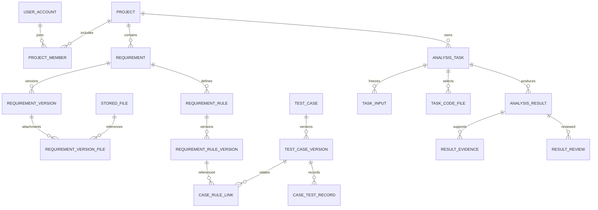

# Test Verity 数据库表结构草案 v0.1

<!-- document-status:start -->
> **历史资料，不再作为当前开发或运行规则。** 初始候选表结构，不代表已建表，不能据此建库。 当前说明见[models.py](../backend/app/db/models.py)、[versions](../backend/migrations/versions)。 查阅分类见[文档整理清单](DOCUMENT_REVIEW.md)。
<!-- document-status:end -->

2026-10-10：变更分析已通过迁移20261010_30新增change_analysis_task和change_analysis_chat_turn，固定双侧输入/报告/审计及独立对话均按项目保存，所有表/字段真实中文COMMENT与ORM一致。当前结构以模型与迁移为准，本稿其他未授权建议表不自动创建；详见[CHANGE_ANALYSIS.md](CHANGE_ANALYSIS.md)。

日期：2026-09-11。状态：供用户审阅，未授权实施。

后续实施补充：用户已单独授权登录与账号管理，实际用户表及新增会话表见 `LOGIN_ACCOUNTS.md`；本稿其余候选表仍是待审阅设计，不代表已建表。

本文仅设计表结构，没有创建数据库、业务模型或 Alembic 迁移。表名、字段、状态值、删除与确认流程均为建议；确认本文的框架不等于授权实现全部业务功能。界面仍以已有 HTML 原型为准，不因数据库设计增加或修改菜单、字段和交互。

## 1. 已确认的边界

- PostgreSQL 单库共享表，项目数据按项目隔离。
- 原始文件放后端私有目录，数据库保存文件信息。有历史引用的数据归档保留。
- 需求、规则、用例和输出模板保留版本；草稿可编辑，确认或发布后锁定内容，修改产生新版。任务固定实际使用的输入版本。
- Skill 按功能存本地目录，平台只读展示；直接编辑本地文件，新任务读取最新内容。任务启动时保存实际使用的内容快照与校验值，不建立 Skill 编辑、发布版本表。
- AI 候选结果经过校验与人工确认后才能成为正式数据；审核通过不等于测试通过。
- Git 只允许读取、clone/fetch，不能执行远端写入；不提供任意 Git 命令或任意脚本接口。

## 2. 总体结构

以下是覆盖已讨论功能的逻辑全景，共 29 张候选表，并非首批建表计划。按模块确认后逐批落地，不预建未确认模块。

| 数据域 | 候选表 |
| --- | --- |
| 账号与项目 | user_account、project、project_member |
| 文件与需求 | stored_file、requirement、requirement_version、requirement_version_file |
| 需求规则 | requirement_rule、requirement_rule_version、rule_evidence |
| 用例 | test_case、test_case_version、case_rule_link、case_test_record |
| 仓库与接口 | project_repository、repository_snapshot、interface_document、interface_document_version |
| 模板与配置 | output_template、output_template_version、project_module_config、ai_connection |
| 任务与结果 | analysis_task、task_input、task_code_file、analysis_result、result_evidence、result_review、audit_event |

不另建报告副本表、Skill 表、角色权限配置表、文件全文向量表或通用工作流表。



图中仅展示主链路，具体外键以下文为准。

## 3. 公共字段和约束

### 3.1 类型约定

- `id`：`bigint GENERATED ... AS IDENTITY`，内部主键，不等于需求编号或用例编号。
- 所有表含 `created_at timestamptz NOT NULL`，由数据库写入创建时间。
- 可编辑主记录含 `updated_at timestamptz NOT NULL`、`lock_version integer NOT NULL DEFAULT 1`。更新时检查旧修订号，防止多人静默覆盖。
- 下文 `?` 表示允许为空，其他字段原则上必填；注明默认值的字段可由系统补齐。
- `user_id`、`created_by`、`reviewed_by` 等均引用 `user_account.id`；操作人账号停用但保留引用。
- 状态采用 `text + CHECK`，状态值是待确认的建议，不代表已确定全部流转规则。
- 正文使用 `text`；原型没有确定长度的文本，本稿不凭空限制为 50/100 字。
- JSONB 仅用于有结构校验的快照、定位、模板定义和扩展内容；不将权限、外键和主要查询条件藏进 JSON。

### 3.2 项目隔离

除平台账号、平台模板和平台 AI 配置外，业务表均含 `project_id bigint NOT NULL`，引用 `project.id`，字段表中不再重复列出。

项目业务表提供 `UNIQUE(project_id, id)`。项目内部引用使用 `(project_id, parent_id)` 组合外键，避免把项目 A 的用例关联到项目 B 的规则。规则版本等还需组合约束其所属需求一致，不能仅验证同项目。

后端仍必须检查当前用户的项目成员身份和操作权限；外键不能代替访问控制。平台管理员的访问范围需在账号权限模块单独确认。

### 3.3 版本与归档

- 主表保存稳定身份、编号、归档状态；版本表保存可变化的业务正文。
- 同一对象 `UNIQUE(parent_id, version_no)`。正式版本禁止更新正文；通过应用写入规则与数据库约束/触发器实施，具体迁移时审查。
- 草稿允许编辑；分析任务如果使用草稿，必须额外保存其实际内容和修订号，不能只引用会变化的草稿 ID。
- 发布、确认、驳回、归档等操作写审计记录；不把业务内容更新历史全部塞进审计日志。
- 正式历史引用默认限制删除，不使用级联删除清空项目历史。草稿清理与文件保留期限另行确认。
- 不额外维护 `current_version_id`。先按父对象和版本状态查询最新版本，避免维护两份“当前版本”关系。

## 4. 账号与项目

### 01. user_account — 平台账号

含公共可编辑字段。

| 字段 | 类型 | 含义 |
| --- | --- | --- |
| login_name | text | 登录名，唯一；大小写归一化规则待登录模块确认 |
| display_name | text | 展示姓名 |
| password_hash | text | 密码哈希，绝不保存原密码；算法随登录方案确认 |
| platform_role | text | 建议 ADMIN / USER |
| status | text | 建议 ACTIVE / DISABLED |

不提前设计找回密码、会话、邀请令牌字段或表，待登录流程确认；这不表示完整登录系统只需要本表。

### 02. project — 项目

含公共可编辑字段，不含重复的 `project_id`。

| 字段 | 类型 | 含义 |
| --- | --- | --- |
| name | text | 项目名称 |
| description | text? | 项目说明 |
| status | text | ACTIVE / ARCHIVED |
| created_by | bigint | 创建人 |
| archived_at | timestamptz? | 归档时间 |

负责人身份以成员表为准，不另存一份负责人字段。允许一位或多位负责人须另行确认。

### 03. project_member — 项目成员

含公共可编辑字段。

| 字段 | 类型 | 含义 |
| --- | --- | --- |
| user_id | bigint | 平台账号 |
| project_role | text | OWNER / MEMBER，表示项目负责人/成员 |
| duties | text[] | PRODUCT / DEVELOPMENT / TEST，多职责标记，默认空数组，不赋予权限 |
| status | text | ACTIVE / REMOVED |
| added_by | bigint | 添加人 |

约束：`UNIQUE(project_id, user_id)`。移除成员保留历史身份记录。指定谁可以确认需求和用例的授权粒度仍待确认，不预设通用 RBAC 表。

## 5. 文件与需求

### 04. stored_file — 私有文件登记

| 字段 | 类型 | 含义 |
| --- | --- | --- |
| original_name | text | 上传文件名，只作展示 |
| storage_key | text | 后端生成的私有存储标识，不使用用户传入的绝对路径 |
| media_type | text | 后端核验的文件类型 |
| byte_size | bigint | 文件大小，必须非负 |
| sha256 | text | 内容校验值 |
| uploaded_by | bigint | 上传者 |
| parse_status | text | NOT_STARTED / PROCESSING / SUCCEEDED / FAILED / UNSUPPORTED |
| parsed_storage_key | text? | 解析文本及页/段/单元格索引的私有产物位置 |
| parser_version | text? | 解析器版本 |
| parse_error_code | text? | 不含凭据、原文及堆栈的失败码 |

`storage_key` 唯一；`sha256` 不做跨项目唯一或自动跨项目共享。原件不可覆盖。重新解析若会影响既有任务证据，生成新产物并由任务保留旧产物引用，不覆盖已有定位内容。

### 05. requirement — 需求稳定身份

含公共可编辑字段。

| 字段 | 类型 | 含义 |
| --- | --- | --- |
| requirement_no | text | 项目内需求编号 |
| status | text | ACTIVE / ARCHIVED |
| created_by | bigint | 创建人 |
| archived_at | timestamptz? | 归档时间 |

约束：`UNIQUE(project_id, requirement_no)`。需求标题和正文放在版本中，避免改名后历史报告变化。

### 06. requirement_version — 需求版本

含公共可编辑字段，仅草稿正文允许修改。

| 字段 | 类型 | 含义 |
| --- | --- | --- |
| requirement_id | bigint | 所属需求 |
| version_no | integer | 从 1 开始 |
| title | text | 此版本的需求标题 |
| description | text? | 此版本的说明或正文 |
| update_mode | text | INITIAL / FULL_REPLACEMENT / INCREMENTAL，建议值 |
| base_version_id | bigint? | 增量或比较的同需求基准版本 |
| status | text | DRAFT / CONFIRMED |
| created_by | bigint | 创建人 |
| confirmed_by | bigint? | 确认人 |
| confirmed_at | timestamptz? | 确认时间 |

增量补充只记录与基准的关系，不把附件未提及的条目自动当成删除；合成有效基准及冲突确认流程须在需求变更模块确认。自引用需约束同一需求且基准版本早于本版。

### 07. requirement_version_file — 需求版本附件

| 字段 | 类型 | 含义 |
| --- | --- | --- |
| requirement_version_id | bigint | 需求版本 |
| file_id | bigint | 原始文件 |
| sort_order | integer | 附件展示顺序 |
| description | text? | 附件用途说明 |

约束：`UNIQUE(requirement_version_id, file_id)`。一个需求版本支持多个附件；同一项目文件可由多个版本引用，不复制原件。

## 6. 需求规则

### 08. requirement_rule — 规则稳定身份

含公共可编辑字段。

| 字段 | 类型 | 含义 |
| --- | --- | --- |
| requirement_id | bigint | 所属需求 |
| rule_no | text | 同需求内稳定规则编号 |
| status | text | ACTIVE / ARCHIVED |
| created_by | bigint | 创建人 |

约束：`UNIQUE(requirement_id, rule_no)`。规则拆分/合并先通过分析结果保存建议与原规则引用，正式关联结构待变更流程确认后决定。

### 09. requirement_rule_version — 规则内容版本

含公共可编辑字段，仅草稿正文允许修改。

| 字段 | 类型 | 含义 |
| --- | --- | --- |
| rule_id | bigint | 规则身份 |
| requirement_id | bigint | 用于约束规则与需求版本同属一个需求 |
| requirement_version_id | bigint | 本规则对应的需求版本 |
| version_no | integer | 同规则下递增 |
| title | text | 验收点名称 |
| precondition | text? | 前提条件 |
| expected_behavior | text | 预期业务行为 |
| status | text | DRAFT / CONFIRMED |
| created_by | bigint | 创建人 |
| confirmed_by | bigint? | 确认人 |
| confirmed_at | timestamptz? | 确认时间 |

规则版本集合如何整体确认为一个需求基准，在需求分析模块确认；本稿不假设所有规则自动随需求确认。AI未确认规则先留在候选结果中，不提前写成正式规则。

### 10. rule_evidence — 规则原文依据

| 字段 | 类型 | 含义 |
| --- | --- | --- |
| rule_version_id | bigint | 规则版本 |
| requirement_version_file_id | bigint | 对应需求版本中的附件关联 |
| locator | jsonb | 按文件类型校验：页码、段落、工作表/单元格、图片区域等 |
| excerpt | text | 支撑规则的原文摘录 |

关联需验证附件属于该规则的需求版本；允许一条规则有多处依据。无依据的AI补充建议保留在候选结果中，不伪造原文位置。

## 7. 用例管理

### 11. test_case — 用例稳定身份

含公共可编辑字段。

| 字段 | 类型 | 含义 |
| --- | --- | --- |
| sequence_no | bigint | 平台展示序号，建议项目内唯一 |
| case_no | text | 用例编号，导入原编号保留 |
| status | text | ACTIVE / ARCHIVED |
| created_by | bigint | 创建人 |
| archived_at | timestamptz? | 归档时间 |

约束：`UNIQUE(project_id, case_no)`、建议 `UNIQUE(project_id, sequence_no)`。编号按模块前缀续号的解析规则、导入冲突处理需确认；不能用无并发保护的 `MAX+1`。实施时采用事务内分配和唯一约束，不以新增通用编号服务为前提。

### 12. test_case_version — 用例设计版本

含公共可编辑字段，仅草稿正文允许修改。

| 字段 | 类型 | 对应内容 |
| --- | --- | --- |
| case_id | bigint | 用例身份 |
| version_no | integer | 版本号 |
| functional_module | text | 功能模块，例如配件订货 |
| functional_structure | text | 功能结构，例如确认信息 |
| case_type | text | 用例类型，取值字典后续确认，保留导入原值 |
| priority | text | 优先级，允许值与导入映射后续确认 |
| description | text | 用例描述 |
| verification_item | text | 验证用例子项，即场景 |
| preconditions | text | 前置条件，保留换行 |
| operation_steps | text | 操作步骤，保留编号及换行 |
| expected_result | text | 场景级预期结果，不校验与步骤行数相等 |
| remarks | text? | 备注 |
| extra_fields | jsonb | 模板允许的扩展字段，默认空对象 |
| template_version_id | bigint? | 定义扩展字段的模板版本 |
| status | text | DRAFT / CONFIRMED |
| source_kind | text | MANUAL / IMPORT / AI_CONFIRMED |
| source_file_id | bigint? | 导入源文件 |
| source_locator | jsonb? | 导入工作表、行号、原始序号等 |
| created_by | bigint | 创建人/确认入库操作人 |
| confirmed_by | bigint? | 确认人 |
| confirmed_at | timestamptz? | 确认时间 |

AI来源可沿 `result_review` 追到原候选结果和任务，不重复拷贝来源链。

### 13. case_rule_link — 用例与规则关联

| 字段 | 类型 | 含义 |
| --- | --- | --- |
| case_version_id | bigint | 用例版本 |
| rule_version_id | bigint | 规则版本 |
| created_by | bigint | 建立关联的人员 |

约束：`UNIQUE(case_version_id, rule_version_id)`。一条用例可以关联多条规则；建立关联不自动等于完整覆盖。覆盖结论属于某次分析结果，需携带依据。

### 14. case_test_record — 测试记录

追加保存，纠错通过新增记录并引用被更正记录，不静默覆盖。

| 字段 | 类型 | 含义 |
| --- | --- | --- |
| case_version_id | bigint | 结果属于哪个用例版本 |
| source_kind | text | MANUAL / IMPORT，不支持AI自动执行来源 |
| result | text | NOT_RUN / PASSED / FAILED / BLOCKED / OTHER，映射待确认 |
| original_result | text? | 导入的原始测试结果，包括无法映射的值 |
| tester_user_id | bigint? | 可关联的平台测试人员 |
| tester_name | text? | 导入或记录时的测试人员名称，不因用户改名改写 |
| tested_at | timestamptz? | 真实测试时间；导入未提供则留空，不用导入时间冒充 |
| notes | text? | 本次测试补充说明 |
| source_file_id | bigint? | 导入来源 |
| source_locator | jsonb? | 来源工作表/行等 |
| supersedes_id | bigint? | 更正的同用例版本旧记录 |
| recorded_by | bigint | 平台录入人，不等于测试人员 |

AI新用例没有测试记录时，展示“未执行”，测试人员留空。旧版本记录不自动关联新版。默认展示哪次记录、导入是否覆盖当前显示，需用例模块确认；旧记录始终保留。

### 14列展示对应关系

| 列序 | 页面/Excel列 | 来源 |
| --- | --- | --- |
| 1 | 序号 | test_case.sequence_no |
| 2 | 用例编号 | test_case.case_no |
| 3 | 功能模块 | test_case_version.functional_module |
| 4 | 功能结构 | test_case_version.functional_structure |
| 5 | 用例类型 | test_case_version.case_type |
| 6 | 优先级 | test_case_version.priority |
| 7 | 用例描述 | test_case_version.description |
| 8 | 验证用例子项 | test_case_version.verification_item |
| 9 | 前置条件 | test_case_version.preconditions |
| 10 | 操作步骤 | test_case_version.operation_steps |
| 11 | 预期结果 | test_case_version.expected_result |
| 12 | 测试结果 | 该版本按确认规则选定的 case_test_record；无记录显示未执行 |
| 13 | 测试人员 | 同一测试记录的测试人员；无记录留空 |
| 14 | 备注 | test_case_version.remarks |

需求关联、审核状态、版本和证据放详情，不挤占14列。

## 8. 仓库与接口资料

### 15. project_repository — 项目仓库

含公共可编辑字段。

| 字段 | 类型 | 含义 |
| --- | --- | --- |
| name | text | 展示名称 |
| repository_url | text | 已确认的指定仓库地址，禁止内嵌Token |
| code_role | text | BACKEND / FRONTEND / OTHER，用于区分项目中的仓库 |
| credential_ref | text? | 后端密钥存储引用，不是密钥明文 |
| status | text | ACTIVE / DISABLED |
| created_by | bigint | 配置人 |

建议 `UNIQUE(project_id, repository_url)`，URL规范化规则实施时确认。无 `allow_push`、任意命令或脚本字段；只读操作白名单由后端强制实现。

### 16. repository_snapshot — 固定提交快照

| 字段 | 类型 | 含义 |
| --- | --- | --- |
| repository_id | bigint | 仓库 |
| commit_sha | text | 完整提交标识，不能只保存分支名称 |
| checkout_storage_key | text | 后端私有快照位置，非用户输入路径 |
| captured_by | bigint | 获取人 |

约束：`UNIQUE(repository_id, commit_sha)`。选择时的分支/Tag/PR名称存任务输入，因为不同选择可以解析为同一个提交。快照不允许读取确认范围之外的其他仓库。

### 17. interface_document — 接口资料身份

含公共可编辑字段。

| 字段 | 类型 | 含义 |
| --- | --- | --- |
| name | text | 资料显示名称，任务快照保存当时名称 |
| status | text | ACTIVE / ARCHIVED |
| created_by | bigint | 创建人 |

### 18. interface_document_version — 接口资料版本

| 字段 | 类型 | 含义 |
| --- | --- | --- |
| interface_document_id | bigint | 所属资料 |
| version_no | integer | 版本号 |
| file_id | bigint | 手动上传的原始资料 |
| source_format | text | APIFOX_EXPORT / OPENAPI，具体支持格式待确认 |
| parse_status | text | PENDING / SUCCEEDED / FAILED |
| normalized_storage_key | text? | 解析后的结构化契约产物位置 |
| parser_version | text? | 解析器版本 |
| parse_error_code | text? | 不泄密的错误码 |
| created_by | bigint | 上传人 |

约束：`UNIQUE(interface_document_id, version_no)`。不配置 Apifox 在线连接；首期不预拆接口、参数、响应字段多层表，待接口资料检索与编辑需求确认后判断。

## 9. 模板与配置

### 19. output_template — 输出模板身份

含公共可编辑字段。允许平台模板，因此本表的 `project_id` 可为空。

| 字段 | 类型 | 含义 |
| --- | --- | --- |
| project_id | bigint? | NULL为平台模板，有值为项目专用模板 |
| module_key | text | 所属分析/生成模块，后端固定白名单 |
| name | text | 模板名称 |
| status | text | ACTIVE / ARCHIVED |
| created_by | bigint | 创建人 |

### 20. output_template_version — 模板内容版本

项目作用域从父模板继承；平台版本同样允许 `project_id` 为空。含公共可编辑字段，发布后正文不可变。

| 字段 | 类型 | 含义 |
| --- | --- | --- |
| template_id | bigint | 所属模板 |
| version_no | integer | 版本号 |
| definition | jsonb | 版本化字段定义：稳定字段标识、展示名、类型、必填、顺序、扩展字段 |
| status | text | DRAFT / PUBLISHED |
| created_by | bigint | 创建人 |
| published_by | bigint? | 发布人 |
| published_at | timestamptz? | 发布时间 |

约束：`UNIQUE(template_id, version_no)`。模板定义由可视化界面生成，不能要求用户编辑JSON；固定14列和追溯字段由平台约束，不允许模板删掉。

平台/项目模板的作用域一致性不能依赖可空组合外键“自动保证”。实现时需用审查后的约束触发器或等效方案，验证版本与父模板作用域一致，项目引用只能使用本项目或平台模板。

### 21. project_module_config — 项目模块配置

含公共可编辑字段。

| 字段 | 类型 | 含义 |
| --- | --- | --- |
| module_key | text | 固定模块标识 |
| template_version_id | bigint | 当前绑定的已发布模板版本 |
| ai_connection_id | bigint | 所选后端AI配置 |
| updated_by | bigint | 最近配置人 |

约束：`UNIQUE(project_id, module_key)`。检查模板模块与当前模块一致，且模板/AI配置属于本项目或平台允许的作用域。是否允许项目自行选择模型和模板需配置模块确认。

不存 Skill 正文或可编辑路径。后端按固定模块映射解析本地目录，例如：

```text
backend/skills/
  requirements/SKILL.md
  generate/SKILL.md
  coverage/SKILL.md
  code/SKILL.md
  changes/SKILL.md
```

这是路径建议，目录尚未创建。首期按单个 `SKILL.md` 正文读取；若以后允许引用其他文件，所有实际读取内容也须纳入任务快照，不执行其中的脚本或任意路径读取。

### 22. ai_connection — AI连接配置

含公共可编辑字段。作用域建议先支持平台配置，项目专用是否开放待确认。

| 字段 | 类型 | 含义 |
| --- | --- | --- |
| project_id | bigint? | NULL为平台配置 |
| name | text | 配置名称 |
| provider | text | 首期固定 OPENAI，不预建多供应商适配器 |
| model | text | 模型标识 |
| credential_ref | text | 后端密钥引用，不保存到任务快照或前端 |
| timeout_seconds | integer | 请求超时，必须大于0 |
| status | text | ACTIVE / DISABLED |
| updated_by | bigint | 配置人 |

真实密钥的保存、加密、轮换和AI资料发送范围需要另行确认。此表不是授权向模型发送内部资料。

## 10. 分析任务与结果

### 23. analysis_task — 分析任务历史草案

2026-10-14：独立“任务与报告”页面已按用户要求移除。本节为历史数据库设计草案，不作为新建统一任务/报告表的授权；现有分析模块任务、报告和审计数据保留在各自实现中。

任务执行字段可更新；输入冻结后不可变。

| 字段 | 类型 | 含义 |
| --- | --- | --- |
| module_key | text | 需求分析/用例生成/用例分析/代码分析/变更分析等固定标识 |
| title | text | 任务名称 |
| status | text | QUEUED / RUNNING / SUCCEEDED / FAILED / CANCELLED，流转待确认 |
| requested_by | bigint | 发起人 |
| template_version_id | bigint | 本次模板发布版本 |
| ai_connection_id | bigint | 连接配置来源，实际参数另存快照 |
| skill_relative_path | text | 固定映射下的实际Skill相对路径 |
| skill_content | text | 本次实际使用的完整Skill文本 |
| skill_sha256 | text | 同一份文本的内容校验值 |
| model_config_snapshot | jsonb | 本次实际模型标识、非敏感参数、提示组装版本等，禁止密钥 |
| additional_focus | text? | 用户本次补充关注点，视为低优先级输入 |
| input_manifest_sha256 | text | 对实际输入清单与内容快照计算的校验值 |
| input_frozen_at | timestamptz | 输入冻结时间 |
| started_at | timestamptz? | 开始时间 |
| finished_at | timestamptz? | 完成时间 |
| error_code | text? | 不含敏感信息的失败码 |
| updated_at | timestamptz | 状态更新时间 |

建议在任务正式入队时冻结 Skill 和输入，而不是等 Worker 很久后才读最新文件。读取正文、校验和保存必须针对同一份字节；后续修改本地Skill只影响下一任务。

任务与输入在同一事务内保存，缺Skill、无有效输入或权限不足不得创建一个可执行的成功任务。Worker领取、租约、心跳、重试和取消需要单独确认后再补字段，不用本稿宣称可靠任务队列已经设计完毕。

任务成功仅表示本次分析运行完成，不等于用例测试通过或业务实现正确。报告查询本任务、结果、证据和处理记录；导出是其呈现，不再复制一套可独立修改的报告结论。

### 24. task_input — 本次输入与版本快照

| 字段 | 类型 | 含义 |
| --- | --- | --- |
| task_id | bigint | 任务 |
| input_role | text | INPUT / BASE / TARGET，区分普通输入与变更前后基准 |
| requirement_version_id | bigint? | 需求版本 |
| rule_version_id | bigint? | 规则版本 |
| case_version_id | bigint? | 用例版本 |
| interface_version_id | bigint? | 接口资料版本 |
| repository_snapshot_id | bigint? | 仓库提交快照 |
| content_snapshot | jsonb | 实际输入的正文或不可变私有产物清单、名称、状态、修订号和校验值 |
| selected_ref | text? | 仓库选择时的分支/Tag/提交/PR标识 |

五个版本外键必须恰好有一个非空，使用数据库CHECK约束；按目标类型建立适当唯一索引，防止同一角色重复输入。变更任务可以引用两个提交快照；分析任务可以关联多个需求和多个仓库。

已确认版本也保留实际选择范围，例如使用哪些附件、规则；不能后来根据“当前全部规则”重算旧任务。JSON中的资料标识必须由后端从授权且已选中的对象构造并校验，不直接信任客户端传入的路径或ID。

### 25. task_code_file — 任务最终代码文件清单

| 字段 | 类型 | 含义 |
| --- | --- | --- |
| task_input_id | bigint | 必须引用本任务的仓库快照类型输入 |
| relative_path | text | 经文件树选择的仓库内相对路径 |
| selection_origin | text | USER / CHANGE_DEFAULT / AI_SUGGESTION_CONFIRMED |
| presence | text | PRESENT / ABSENT，变更前后不存在的文件可记录ABSENT |
| content_sha256 | text? | 存在文件的实际内容校验值 |
| content_storage_key | text? | 任务实际读取内容的不可变私有位置 |

约束：`UNIQUE(task_input_id, relative_path)`。文件路径须从对应提交的文件树验证；防目录穿越、符号链接越界及未确认范围扩展。ABSENT无内容位置，PRESENT有内容位置和校验值；二进制/无法解析文件应在结果中明确证据不足，不假装已经分析。

新增/删除/重命名通过BASE、TARGET两份输入及其文件清单表达；重命名关系可作为变更结果保存，不凭空补齐不存在的文件。

### 26. analysis_result — 原始候选结果/发现

候选正文一经保存不覆盖；修正产生新记录。

| 字段 | 类型 | 含义 |
| --- | --- | --- |
| task_id | bigint | 来源任务 |
| result_kind | text | RULE_CANDIDATE / CASE_CANDIDATE / COVERAGE / CODE_FINDING / CHANGE_IMPACT / REQUIREMENT_ISSUE等模块允许值 |
| title | text | 条目标题 |
| conclusion | text? | DEVIATION / NO_DEVIATION_FOUND / INSUFFICIENT_EVIDENCE；不适用的候选可为空 |
| severity | text? | HIGH / MEDIUM / LOW，具体等级待确认 |
| payload | jsonb | 按本任务模板校验的结构化正文 |
| validation_status | text | PENDING / VALID / INVALID |
| validation_errors | jsonb | 具体字段错误，默认空数组 |
| revision_of_id | bigint? | 同任务中被修正的旧候选 |

用例覆盖结果须包含明确的规则版本、用例版本和覆盖级别（完整/部分/未覆盖/待判断）；这些ID必须校验属于任务输入。尚未确定覆盖率分母与部分覆盖判定，本稿不固定计算公式。

不存在“AI把新用例测试结果写为通过”的能力。结构校验通过只能进入人工确认流程；纠正候选时仍保留原候选，不能覆盖原报告证据。

### 27. result_evidence — 分析结果证据

| 字段 | 类型 | 含义 |
| --- | --- | --- |
| result_id | bigint | 分析结果 |
| task_input_id | bigint? | 需求、规则、用例、接口等已冻结输入 |
| task_code_file_id | bigint? | 本任务实际选择的代码文件 |
| locator | jsonb | 文件附件标识、页/段/单元格/接口operation/代码起止行等有类型的定位 |
| excerpt | text | 最小必要原文或代码摘录 |
| explanation | text? | 此证据如何支撑该结论 |

两个来源外键恰好一个非空，并验证来源与结果属于同一任务。代码证据必须指向PRESENT文件；ABSENT可作为变更事实但不能伪造代码摘录。对JSON内的附件定位，需检查它确实存在于被引用的输入快照。

### 28. result_review — 人工处理记录

追加保存，保留处理历史。

| 字段 | 类型 | 含义 |
| --- | --- | --- |
| result_id | bigint | 候选/发现 |
| action | text | APPROVE / REJECT / MARK_HANDLED / REOPEN，按结果类型约束 |
| comment | text? | 人工意见 |
| reviewed_by | bigint | 实际处理人 |
| accepted_rule_version_id | bigint? | 确认入库产生/关联的规则版本 |
| accepted_case_version_id | bigint? | 确认入库产生/关联的用例版本 |

同一候选的正式入库与批准记录同事务提交；按候选类型限制目标，两个目标不得同时存在；防重复确认，批准入库使用受约束的唯一记录。发现类结果无需入库目标，MARK_HANDLED不等于测试通过。

最新处理状态由记录查询，不另维护容易不同步的布尔值。具体谁有权限确认、能否撤销确认、重复用例如何合并，需要业务确认；本稿不默认允许撤回后删掉历史版本。

### 29. audit_event — 关键操作审计

追加写入，不保存原始公司资料、密码或Token。平台操作允许 `project_id` 为空。

| 字段 | 类型 | 含义 |
| --- | --- | --- |
| project_id | bigint? | 所属项目，平台操作可空 |
| actor_user_id | bigint? | 操作人；系统事件可空 |
| event_type | text | 成员调整、资料确认、模板发布、归档、配置变更等固定类别 |
| target_type | text | 对象类型，仅用于审计定位 |
| target_id | bigint? | 对象ID；不是业务关系或权限依据 |
| summary | text | 脱敏摘要 |
| metadata | jsonb | 允许字段白名单内的变化说明和请求标识，不放完整正文/提示词 |

## 11. 必须落实的约束和查询索引

1. 所有业务父子关系验证同项目；规则与需求版本、证据与任务等进一步验证同一业务父对象。涉及跨层关系时增加所需组合键或约束触发器，不只靠页面校验。
2. 对象版本号、项目用例编号、项目成员、模块绑定等使用唯一约束。
3. 版本号大于0、文件大小非负、超时大于0；CONFIRMED/PUBLISHED状态要求确认/发布人和时间齐全。
4. 固定版本内容和任务冻结输入不可更新；任务状态、文件解析状态等运行字段按各自允许流程变更。
5. 项目列表常用索引建议 `(project_id, status, created_at DESC)`；版本表使用 `(parent_id, version_no DESC)`；外键列按实际连接查询建立索引，PostgreSQL不会自动为所有引用端外键建索引。
6. 任务列表按 `(project_id, created_at DESC)`；模块/状态组合索引、Worker队列索引在实际查询与领取方案确定后添加。
7. 结果按 `(task_id, result_kind)`；审核记录按 `(result_id, created_at DESC, id DESC)`；同一版本测试记录按 `(case_version_id, created_at DESC, id DESC)`。
8. 不默认给每个JSONB字段加GIN索引、不给每个字段建索引；根据确认后的检索需求追加。

## 12. 拟定落地顺序与本轮审阅重点

建议顺序，不代表已获得实施授权：

1. 先确认账号与项目权限流程，再落地账号、项目、成员及所需会话结构。
2. 确认资料上传、版本和原文定位，再落地文件、需求、规则。
3. 确认14列导入、编号、人工确认和测试记录，再落地用例。
4. 确认仓库只读、接口资料和文件选择范围，再落地代码与接口资料。
5. 确认AI数据发送、模板、任务执行及结果处理，再落地配置、任务和证据。

请先审阅：数据域是否齐全；需求/规则/用例拆分是否符合使用习惯；测试记录与用例设计分开是否合适；任务保留输入和Skill快照是否足以追溯。账号会话、负责人数量、编号冲突、删除保留期限、任务重试等尚未确认的细节，继续在对应模块确认，不通过本稿默认定案。

本文件与旧交接文档存在一处已知时间差：旧文档中的Skill在线编辑/发布/回退已经被本次用户确认的“本地修改、平台只读、任务保留快照”替代。本轮不改写旧交接记录，也不创建任何业务表。
