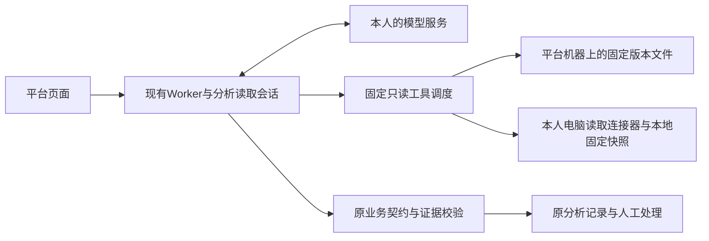

# 本地按需读取分析：可行性与实施方案

<!-- document-status:start -->
> **待评审方案，不代表当前已实现或已授权的能力。** 任意授权范围的按需读取未按此稿全面实现；当前CLI仅读取本任务固定输入，不能混为同一能力。 查阅分类见[文档整理清单](DOCUMENT_REVIEW.md)。
<!-- document-status:end -->

日期：2026-10-16。状态：待评审设计。用户要求给出可行性、方案及实现方法，先不动代码。

本文件提出未来开发方案，不代表功能已接入或获准启动收费分析。本轮只核对现有实现、本机CLI帮助和官方文档，不改程序、Skill、配置、原型、数据库或服务。

2026-10-16后续收敛：首期仅代码分析及变更分析中的代码变更。用户要求日常使用无新增操作，只需知道在调用自己的AI；以下用户流程取代早期“新增执行方式选项／每次填写调用预算／首期覆盖五类”的建议。当前仍只调整设计。

## 1. 结论与当前事实

可实现“整个授权范围供AI读取，AI在分析过程中搜索、读文件、补查关联，再生成报告”。需要补齐读取工具和多轮执行流程；仅把文件路径放进原API请求不会让模型获得磁盘访问能力。

当前有三个必须区分的部分：

| 部分 | 当前实际情况 | 对方案的影响 |
| --- | --- | --- |
| 模型接入 | AI服务的Codex卡片使用本人配置的Responses API，没有调用本机Codex进程 | 个人API配置可以继续复用，但需要新增工具调用协议 |
| 本地目录 | DirectoryHandle及快照保存在当前浏览器IndexedDB，后端仅登记关联元数据 | Worker不能直接使用浏览器句柄，也不能从目录名称反推本机绝对路径 |
| GitHub源码 | 变更分析已经把授权固定blob缓存在平台运行机器，读取后校验Git哈希 | 这批文件可作为第一阶段按需读取的数据源，无须先安装用户电脑连接器 |

本机只读检查得到codex-cli 0.161.0，帮助中提供非交互执行、JSONL事件、输出Schema、只读沙箱及app-server。版本/帮助检查不证明当前中转支持工具调用，也不证明本机目录隔离、结构化报告和取消已集成成功。

同一配置下其他分析成功，说明当前模型配置具备已验证的用途；不能据一次HTTP400断定配置错误。任务331的76.7MiB输入提示单次上下文值得排查，原始拒绝原因没有保存，仍不能认定已证明容量超限。

## 2. 路线比较与推荐

| 路线 | 如何读取文件 | 复用情况 | 主要门槛 | 建议 |
| --- | --- | --- | --- | --- |
| A：个人API＋平台只读工具 | 模型请求读取，Worker或本机读取组件执行固定只读操作，把结果交回模型 | 本人AI配置、现有Worker、权限、缓存、报告及审核 | 本人模型/中转必须支持完整工具调用往返及上下文续接 | 推荐作为平台共用能力 |
| B：本机Codex执行 | 本机组件运行Codex，Codex自行探索目录，平台接收事件和最终JSON | 已安装Codex的读取/上下文管理能力 | 每人运行环境、身份隔离、命令权限、版本与重试行为需要验证 | 真正要复用本机Codex时采用，单独验证后接入 |
| C：仅浏览器执行读工具 | 通过现有DirectoryHandle读取，浏览器与后台交换工具结果 | 当前目录授权无需再安装组件 | 关闭标签、电脑休眠、浏览器权限会阻断后续读取 | 适合前台试验，不满足当前离页后台继续目标 |

推荐A，首期在代码分析及代码变更分析接现有GitHub固定缓存。源码已经位于平台运行机器，无需每个业务用户另装程序或进行设备配对。独立电脑上的私有目录读取按实际需要后续扩展；其他分析沿用当前调用方式，共用能力保留扩展方向。它不要求模型在本机推理；如果还要求离线模型运行，需要另做该服务的协议/能力适配。

若目标是直接复用已安装Codex，B作为部署时确定的执行适配路线，用户在日常分析时不再选择技术模式。Codex可以和平台后台部署在同一台机器，读取该机器上的固定源码；这与读取每位同事个人电脑的目录不同。当前API配置仍不能默认为已经连接本机Codex。

官方依据：Responses支持应用执行工具并返回结果的多轮流程；Codex非交互接口提供机器可读事件和结构化输出。两者的可用接口不等于当前中转已验证兼容。[Function calling](https://developers.openai.com/api/docs/guides/function-calling)、[Codex非交互执行](https://learn.chatgpt.com/docs/non-interactive-mode)。

### 2.1 用户的日常流程

保持“选择项目/来源/范围/固定版本 → 点击开始分析 → 查看进度 → 查看结果”的现有业务流程，不新增执行方式下拉、CLI路径、工具选择、调用轮数、Token预算输入或逐轮确认。用户不手动启动终端、拆文件、切批次、复制提示词、上传每轮结果。

文件准备、旧新区分、搜索补读、上下文整理、正常任务内多轮调用、结果保存均由后台自动完成。页面默认只显示本人AI名称、准备中/分析中/完成/失败等业务阶段；过程与覆盖情况可在原记录中按需展开，失败或未覆盖不能隐藏。费用与资源预算由部署策略设置，正常分析不要求用户逐次配置；达到边界应准确保存未完成状态，不悄悄少分析文件。

用户点“开始分析”才创建收费任务；浏览、刷新、检查本机状态不自动触发收费分析。任务内正常后续轮次不逐轮询问，失败后的收费重发继续复用既有人工重试入口，不自动盲重试。部署前先确认工具能力和执行适配器，不在用户任务中任意切换AI身份或另一种收费方式。

展示名称与实际执行一致：真实通过Codex进程执行时可显示“正在调用本人Codex · 本地执行”；若使用个人模型API加本地文件工具，则显示“正在调用本人AI · 按需读取代码”。本地文件读取、本地Codex进程和模型在本机推理是不同能力，不能把API模式标成已运行本地模型。工具名、调用ID和协议字段不进入日常用户操作。

同机固定源码/已授权GitHub来源可做到用户零新增操作。若未来要读同事电脑私有目录，读取组件可随客户端预装、由部署维护自动启动，但第一次目录授权仍需本人完成；现有目录授权有效时不重复打扰，权限失效才提示。浏览器授权不能被后台静默扩权，首次接入不能承诺零授权读取任意个人磁盘。

## 3. 推荐架构

模型始终通过工具取得数据，文件访问由可信代码按已批准范围执行。平台页面负责发起、进度和审阅，不把本人API Key放进浏览器。

平台部署在自己的电脑、文件也在该电脑时，可由同机受控读取组件完成读取。平台部署在一台服务器、同事从各自电脑访问时，服务器无法直接读取同事磁盘；每台需要读取的电脑必须有已授权读取端。读取端能访问哪些目录，由该电脑的授权决定，不能因为管理员或项目负责人身份自动取得他人的磁盘权限。

### 3.1 只读工具

共用能力限定以下固定操作，不提供任意终端命令、任意URL、文件写入或Git写入。首期接前四项代码读取工具；read_material仅在原代码分析已经选择需求/原型依据时接入，read_cases及其他模块工具等实际扩展需要时再实现，不预建无业务调用的工具目录。

| 工具 | 输入的核心字段 | 返回内容 |
| --- | --- | --- |
| list_files | snapshot_ref、目录/游标 | 固定文件清单、相对路径、角色、大小、哈希、下一页游标 |
| read_file | snapshot_ref、unit_id、起止行或偏移 | 正文、实际范围、内容哈希、是否还有后续内容 |
| search_text | 已批准snapshot_refs、文字/受控搜索条件、游标 | 路径、行号及匹配片段、是否还有结果 |
| get_diff | pair_id、文件映射ID、游标 | 固定旧新版本差异及新增/修改/删除/未变状态 |
| read_material | 固定资料/页面/批注引用、范围 | 已固定的需求、原型文字和批注；附件仍用已有能力 |
| read_cases | 固定用例引用、设计版本、游标 | 授权范围内固定的用例设计及必要处理摘要 |

模型不传绝对目录、数据库SQL或后端URL。snapshot_ref和unit_id由平台生成并映射到获授权原件。每次工具操作核对当前账号/项目/来源权限、任务状态和固定版本；路径解析防越界、符号链接/Windows重解析点逃逸，并复用现有凭据文件排除和正文私钥检查。

大文件可以完整分页读取。分页响应必须明确总范围、下一页和已读范围，不能把只返回前几页当成整份已读；不再引入整仓2000文件或固定合计字节门槛。

### 3.2 文件与版本固定

变更任务继续显式区分旧基准、新目标、补充上下文。模型先获得目录和变化索引，需要正文时再调用读取工具。

GitHub继续固定完整SHA，沿用当前只读读取白名单和项目/仓库/blob哈希隔离缓存。新增文件仅新侧存在、删除文件仅旧侧存在；未变文件可复用同一正文对象，同时保留两侧的版本归属。

用户目录先在授权电脑生成不可覆盖的分析快照。记录相对路径、内容哈希、大小和采集时间窗口；准备时发现文件变化则重新核对，不能把正在编辑的当前文件冒充原固定版本。分析中只读已固定内容。普通目录扫描不声称是操作系统级原子快照。

重试/追问使用原快照。快照或证据缺失时明确阻断，不能偷偷换成最新磁盘内容。历史失败331如切换新分析方式，应由用户新建关联任务并明确固定新的执行模式/Skill快照，不静默改写其原有重试策略。

### 3.3 每轮怎么执行

1. 现有业务执行模块核对项目、当前操作者个人AI配置、固定Skill及来源，创建读取会话和范围清单。
2. 首轮发送分析目标、报告身份、范围索引及必要说明，不把全仓全文装进一个input_text。
3. 模型返回工具请求。平台严格校验工具名、参数和来源；读取端执行并返回实际内容、哈希和范围。
4. 平台保存工具结果原件、调用ID和覆盖进度，按上游协议继续模型上下文。必须处理一轮多个工具调用、流式参数尚未完整、调用ID配对和完整结束事件。
5. 模型继续补查或返回最终结果。平台按实际读取证据和原业务规则做结构、身份、引用、项目权限及版本校验。
6. 合格结果进入现有报告/人工审阅流程。用例入库、历史问题处理、Git写入均不由读取过程自动执行。

只发送本轮新片段不一定等于后续网络请求都很小：无服务端上下文状态时还要传递必要历史。因此应记录请求大小和Token使用，验证当前中转的续接/上下文整理能力；整理保留来源引用，详细代码可通过固定快照再次读取。不能依靠摘要声称模型永久保留全部细节。

## 4. 整个仓库与完整审阅

“全部文件可读”可以实现，但它与“模型已经逐文件审阅完成”需要分别显示。

沿用用户现有选择的范围和检查目标，不新增让用户决定“全量／按需”等技术策略的操作。选择整个目录时，完整范围清单由后台驱动逐文件审阅和必要关联检查；不能只依赖模型主动搜索后自行宣称全覆盖，也不能以按需读取为由悄悄收窄范围。

每个文件至少记录：已纳入范围、实际已返回给模型的行/字节区间、模型声明完成的审阅状态、发现与证据引用、未覆盖/读取失败原因。源文件全部区间都返回后才算完整读取；模型自称看过不能替代读取日志。跨文件关系和业务语义仍由AI分析与人工审阅判断，覆盖计数不证明结论正确。

预算耗尽、设备离线、权限失效或部分文件不能读取时，保留检查点和未覆盖清单。模块支持部分报告时按原契约标记部分完成，否则作为未完成执行保存，不能显示完整成功或零风险。

## 5. 各人电脑上的读取连接器

连接器只承担授权目录的固定清单、搜索、读取及快照校验，推荐路线A下不持有平台个人模型Key。

此节只适用于后续个人电脑私有目录，不是当前GitHub来源分析的日常前置步骤。组件可在客户端安装时预装并完成基础注册；本人首次授权目录后，日常领取任务、连接和凭据续期自动完成。凭据按账号/设备限制作用域并可撤销、过期；根目录实际路径留在设备端，平台使用不透明绑定ID。现有浏览器DirectoryHandle不能直接转交给本机进程，原目录需要一次明确的本机组件授权，不能仅凭同名目录继承历史绑定。

连接器主动连平台的认证通道领取限定任务，不向局域网暴露任意文件读取端口。跨机器长期设备凭据使用加密通道；当前HTTP页面试用设置不自动成为新设备凭据的传输方案。

关闭平台页面后，连接器与Worker仍可继续。电脑关机/休眠或连接器退出时，显示真实“等待本机连接/本机离线”阶段；待设备的任务应释放调度资源，不让唯一Worker一直等待设备，阻塞其他人的分析。取消后不再执行新的读取或模型调用。

## 6. 直接使用本机Codex的实现路线

若选择路线B，优先做受控的非交互任务适配：本机组件用固定可执行文件和参数启动codex exec，消费JSONL事件，并用输出Schema约束最终报告格式。平台仍执行最终业务/证据校验；Schema合格不等于引用真实或业务结论正确。

需要持续交互/对话控制时，可验证官方app-server的stdio协议，按初始化、创建独立会话、开始任务、接收事件、取消/结束的生命周期管理。当前官方文档对app-server命令及WebSocket存在实验性限制，不能仅凭CLI已安装就认定生产级集成完成。网页直接连Codex WebSocket不是推荐架构；官方还记录携带Origin的请求会被拒绝，历史本项目Demo也曾复现。[App Server](https://learn.chatgpt.com/docs/app-server)

SDK/CLI使用的模型身份必须明确属于本次操作者，不复用平台管理员的Codex登录或其他人的历史会话，不自动读取/复制用户auth.json。在平台运行机器由后端管理隔离的Codex子进程时，个人凭据保持在受控后端执行环境，并验证模型生成的工具命令拿不到密钥。若改为在每个人电脑上执行Codex并把后端API Key交给该电脑，则会跨越原“仅后端持有”边界，必须单独评审；路线A的只读连接器不需要持有该Key。

只读沙箱与限定读取范围需要分别验证。官方app-server描述了限制可读根目录的能力，但目标Windows版本的实际阻断效果仍需测试；仅设置cwd或只读模式不够证明无法读其他目录。还必须验证项目脚本执行、外部命令、插件、MCP、Hooks和网络能力的边界。现有平台只读授权不能被Codex默认工具集扩大。若无法落实只读白名单与强制隔离，该执行方式不能进入正式入口。

官方配置包含请求和流中断重试参数；平台既有规则要求失败后人工决定重试，集成应显式禁用未授权重发并验证实际行为，不沿用未核对的默认重试。[配置参考](https://learn.chatgpt.com/docs/config-file/config-reference)

本路线的身份隔离、目录限制、自动重发控制及读取覆盖证明，比路线A更复杂，是选择成本，不应在实施中省略。

## 7. 如何落到现有工程

以下是候选改动位置，不是已创建的业务模块。

| 位置 | 拟承担的职责 |
| --- | --- |
| integrations/responses | 收发模型工具调用及流事件；只处理外部协议，保持无DB/业务依赖 |
| modules/analysis_read | 五类分析共用的固定读取会话、预算、工具参数校验、调度及审计；只注册已定义工具 |
| 代码分析／代码变更的execution/source模块 | 首期构建自身固定范围、调用共用能力、验证原领域契约和保存结果；其他模块后续按需求复用 |
| 本机读取程序 | 在授权电脑执行固定读操作，生成/读取个人本地快照；作为Python后端工程内的独立可打包入口规划 |
| 前端原代码分析/变更页 | 保留现有开始入口，显示本人AI和真实业务阶段；覆盖详情按需展开，不新增技术选项或逐轮操作 |

依赖方向为原业务执行层调用公共读取能力，公共能力不反向调用五个业务执行器。模型客户端不处理项目权限；本地读取程序不直接访问平台业务数据库。不建设任意工具注册平台、通用脚本执行器、向量数据库或额外Agent框架。

共用会话至少需要持久化任务归属、执行方式、固定范围索引、模型配置版本、检查点、预算使用和当前阶段。读取证据/工具过程使用任务私有文件保存，列表只查小摘要，不把全仓正文/完整轨迹放进轮询响应。跨电脑阶段另需设备及目录授权绑定。具体新表或现有表扩展在建模评审时确定，新增字段全部带真实中文COMMENT和Alembic迁移；本轮不预先改表。

工具使用协议、输入索引及Skill需版本化。旧版完整input/report、原任务和重试策略继续按原版本处理。可继续复用的最终报告契约保留；服务端保留完整规范输入或可验证的固定正文对象，按需组装证据校验。不得把空正文冒充旧版完整input，也不能通过放松引用/项目校验来迁就新方式。

Worker保留现有后台执行入口。多轮读取会话在安全检查点释放调度，不为离线设备长期占住唯一Worker；领取仍有数据库锁/租约，恢复时区分“已完成并固定结果”“尚未发送”“已发送但结果未知”。最后一种不得自动再发模型请求。首期不以增加更多Worker进程来绕过幂等与恢复设计。

## 8. 实施顺序与验收

| 阶段 | 工作 | 验收后才能进入下一阶段 |
| --- | --- | --- |
| 1. 小范围能力验证 | 用合成文件和模拟模型验证读工具；获准后使用本人服务做最小真实工具调用往返 | 工具请求→实际读取→最终回答走通；固定版本、越界阻断、失败不自动重发均可证明 |
| 2. 代码分析与代码变更接入 | 使用平台运行机器的固定源码／GitHub缓存，自动准备与按需读取，旧新角色、过程证据、覆盖及契约版本同步 | 原开始操作即可完成；无需用户安装/配对/选择技术模式；大范围正文不全塞首轮，范围不缩水，未知结果/取消不自动重放 |
| 3. 个人目录按需扩展 | 有明确需求时预装读取组件，接一次目录授权、快照、离线等待与恢复 | 已授权用户日常不额外操作；服务端无法越权读其他电脑；关页面继续，关机明确等待 |
| 4. 其他分析按需扩展 | 实际出现大输入需求时再接需求／原型／用例资料，保留各自Skill与人工处理 | 不作为首期改造范围；共用能力与各自权限/输出规则一致 |

若选路线B，阶段1增加本机Codex沙箱、身份、JSONL/Schema、费用重发及取消验证；未通过这些门槛，不能直接用现有真实仓库试跑。

计划验证包括：路径与重解析点逃逸、跨账号/项目/设备、私钥/凭据文件、固定快照变化、完整分页、超大仓库/文件、长对话续接、每轮配置复核、Worker重启边界、取消/预算耗尽、输出证据/人工入库，以及现有五类回归。正式开发运行架构、数据库注释/迁移一致性、前端请求/UI/构建检查。涉及页面先更新当前两份总原型，再实施正式UI。

## 9. 相对既有约定的明确变化

采用新方式需要确认“一个平台任务内允许多轮模型调用”；用户要求的无感体验意味着该过程由后台完成，不再逐轮询问或要求填写技术参数。整仓范围保持，单轮仅带所需内容；调用和预算审计在后台保存，默认用户只看到本人AI和真实分析状态，覆盖详情可展开。预算限制执行消耗，达到边界必须明确未完成，不能悄悄收窄文件范围；失败自动收费重发仍禁止。

首期仅代码分析及代码变更，技术执行方式由部署配置和已验证能力决定，不新增用户模式选择；历史任务保留原固定方式，新任务的执行模式在后台明确记账，不因工具不支持自动切换成另一种收费方式。后续个人电脑目录读取才需要本机组件和一次授权，原浏览器目录授权不能静默扩大。路线B还涉及Codex身份、沙箱及协议稳定性。

当前只提供方案。尚未验证当前中转工具兼容性、运行本机Codex分析、建立设备连接、保证全仓审查完成或证明任务331的具体拒绝原因。
